# ScholarGuide — appendix for the thesis and the defense

Everything that used to be in separate files under `documentation/`, in one place. The main guide is `README.md`.

## Contents

1. [AI Recommendations: how the score works](#a1)
2. [Document checks: what the AI can and cannot prove](#a2)
3. [TES billing reader and the Nov 20 review results](#a3)
4. [Database: tables and relationships](#a4)
5. [Student survey results](#a5)
6. [External grantees](#a6)
7. [General Payroll (Form 6-A)](#a7)
8. [The admin role](#a8)
9. [Demo files for testing](#a9)
10. [End-to-end test plan](#a10)
11. [Video guides](#a11)
12. [Announcement pictures](#a12)
13. [Putting the system online](#a13)

<a id="a1"></a>
## AI Recommendations (rounds 11–12)

ScholarGuide tells OAS staff which students **may be eligible** for each scholarship, with a score from 0% to
100%. This includes students who have **not applied**. It only recommends: staff decide, and the agency still makes
the final decision.

### 1. Which "AI" it is, and why

| Option | Verdict | Why |
|---|---|---|
| A. Rule-based scoring from each scholarship's rules | **Used** | Every score can be explained and checked by hand. It needs no training data. |
| B. Machine-learning classifier trained on past results | Not used | There is no real historical data. The ~300 records in the demo are fictional, so a model would only learn the seeder's random numbers, and any accuracy figure would be made up. |
| C. A combination of both | Not used | The ML half would have the same problem as B. |

In the paper, call it a **rule-based recommender** (a decision-support system), not machine learning.

**Round 12 adds two real AI parts that need no training data** (both pretrained, free, and run on the OAS
computer, so no student data leaves it). The rules above still decide **eligibility**; the AI only **ranks,
explains and suggests**. Nothing is approved by the AI.

| AI part | Model | What it does | Without it |
|---|---|---|---|
| **Field fit** (`ai-service/fit_matcher.py`) | Sentence embeddings, **BAAI/bge-small-en-v1.5** through **fastembed** (pretrained, ~70 MB, CPU) | Compares each student (course, college, year, and their optional *My field and goals*) with each program's description, and tags both with fields of study (Agriculture, Engineering, Computing, …). Programs for the student's field are listed first, and agency-direct programs for their field are shown as *Also for your field*. | TF-IDF word matching (built in). Same fields, rougher similarity. |
| **Memo reader** (`ai-service/rule_reader.py`) | A local large language model through **Ollama** (it uses the model you installed: **qwen2.5:1.5b** or llama3.2:3b) | Staff paste or upload a scholarship memo; the model suggests the GWA, income ceiling, year levels, colleges, one-scholarship rule, documents, deadline and amount, **each with the sentence it came from**. Values whose sentence is not in the memo are marked *check*. Staff tick what is right; it goes into the form; staff press Save. | Simple pattern reading (GWA 2.25, ₱300,000, "first year", document names…). |

Fit levels: **Matches the field** (a shared field), **Close to the field** (similar text, no shared field), **Other
fields**, **Open to all fields** (the program names no field, e.g. TES: this is not a "low fit"). The similarity
number is relative (compare programs for one student); it is **not** a chance of approval.

Why not a model that predicts approval? It would need many real past decisions to learn from. ScholarGuide has none
(the demo data is fictional), so any accuracy figure would be made up.

**Honest limits of the AI parts**
- The fit is only as good as the program descriptions. Before round 12 the demo descriptions were generic, so the
  agency-direct programs now say who they are for, taken from the agencies' own pages (DOST-SEI, ACEF, Landbank,
  NGCP; sources in `DemoDataSeeder::FOCUS`). OAS should update them from each new memo (the memo reader adds a
  *For students in: …* line).
- A field match does not check the program's other conditions (e.g. Iskolar ng Landbank is for children and
  grandchildren of agrarian reform beneficiaries, farmers and fishers). Students are told to check each program.
- A language model can misread a memo. That is why every value shows its sentence, unverified values are marked,
  documents are never ticked automatically, and nothing is saved without staff.
- Tested here with the built-in fallbacks (TF-IDF and patterns): the embedding model and Ollama could not be
  installed in Claude's environment, so check them once on the OAS computer (TEST_PLAN Part P).

#### Setting up the two models (once, with internet)

```
cd ai-service
pip install -r requirements-ai.txt        # fastembed; the model downloads on first use (~70 MB)
```
Ollama: install it from https://ollama.com (Windows installer), then in PowerShell:
```
ollama pull qwen2.5:1.5b                  # about 1 GB; runs on a normal 8 GB laptop
```
Keep Ollama running (it starts with Windows after install). Optional settings in the AI service environment:
`OLLAMA_URL` (default `http://127.0.0.1:11434`), `OLLAMA_MODEL` (empty = use the installed model, qwen2.5:1.5b first), `FIT_MODEL`.
Check: `http://127.0.0.1:8001/fit-status` says `"method": "embeddings"` when the model is in use.

The existing AI parts keep their jobs:
- **PaddleOCR** reads scanned documents and lists.
- **RapidFuzz** compares names (document check and External Grantees).

**Honest limits:**
- The engine is only as good as the rules OAS types in.
- It does not "learn".
- The demo rules are **samples**, not the official CHED or CSU criteria (see section 6).

### 2. Where the criteria come from

Before round 11, `scholarship_requirements` held only **documents to submit**. The `students` table had no GWA or
income. Counting "met requirements" on those tables would only measure how many documents a student has uploaded.
That is readiness, not eligibility.

Round 11 adds the following.

**Scholarship rules** (staff enter them in Scholarships → Manage → *Eligibility rules*; empty = no rule):
- `max_gwa`: highest GWA allowed (1.00 is the best grade)
- `max_family_income`: highest annual family income
- `year_levels`: allowed year levels
- `colleges`: allowed colleges
- `one_scholarship_only`: the student must not hold another active scholarship (on by default)

**Student data** (the student types it on My Profile; OAS checks it):
- `gwa` and `family_income`
- `eligibility_verified_at` and `eligibility_verified_by`: when OAS checked them against the Certificate of Grades
  and the Parents' ITR, and who did

Changing the values removes the check, until OAS checks them again.

### 3. How the score is calculated

For each active scholarship that has at least one rule or required document, and each active student account, the
engine (`backend/app/Support/EligibilityEngine.php`) runs these checks:

| Check | Must-have? | Met when |
|---|:-:|---|
| GWA | yes | student's GWA ≤ highest GWA allowed |
| Family income | yes | income ≤ the ceiling |
| Year level | yes | the year level is in the list |
| College | yes | the college is in the list |
| No other scholarship | yes | no active grantee record in ScholarGuide **and** no active outside scholarship (External Grantees) |
| Each required document | no | not expired **and** either checked by the AI with no problem found (*validated*) or marked *verified* by OAS staff. A file that is only uploaded (not checked yet), flagged, or *needs review* does **not** count |

**Score = points earned ÷ all checks × 100** (changed October 25, 2026). Every check is worth 1 point, but it earns
the full point only when it is backed by something checked:

| Check | Points when met |
|---|---|
| GWA, family income | **1** when OAS verified the figure; **½** when it was only typed by the student |
| Each required document | **1** when OAS staff verified it; when the AI check passed, **how sure the AI was** that the name on it is the student's (e.g. a 92% name match = 0.92) |
| Year level, college | **1**. Source: the student's account (typed at sign-up; later changes need an OAS-approved correction request). There is no Registrar connection, so this is *not* checked against official records; the enrollment check happens later, before tagging. |
| No other scholarship | **1** (ScholarGuide grantee records and the External Grantees lists of the current school year) |
| Anything not met, flagged, expired or not checked | **0** |

So **100% means** every rule is met with OAS-verified data and every required document was checked with no doubt.
A student whose GWA and income are only typed by themselves can reach at most about 80–90%, and the table shows
"Based on what the student typed" next to the score. The "Why?" window shows the points of every check.

**Verdict** (the label staff see):
- **Meets the rules**: every must-have rule is met. The score then shows how ready the student is (documents).
- **Fails a rule**: at least one must-have rule is not met, even if the score is high.
- **Not enough data**: a must-have rule could not be checked (for example, no GWA entered).

Example: the student's income is under the ceiling and they hold no other scholarship. They have uploaded 0 of
the 8 required documents, and OAS has verified their income. The result is "2 of 10 checks met (2 of 2 must-have
rules, 0 of 8 documents); points earned 2 of 10 = 20%", with the verdict *Meets the rules*.

**Weights.** Every check has the same weight (1 point) on purpose. It is simple to explain, and a panel can
check it by hand. Only *how much of the point* is earned depends on whether the data was checked.
Custom weights per rule are left as **future work**: they need OAS policy decisions and testing that cannot be
done before the defense.

**What does 100% mean?** (changed in round 12) It means *every check the program has was met with the data in
ScholarGuide*. It does **not** mean the AI is 100% accurate, and it does not mean the student will be approved:
- The score is a count, not a prediction. No accuracy figure has been measured, so none is claimed.
- GWA and family income are typed by the student. Rows show **GWA/income not checked** until OAS staff mark them
  checked (after seeing the Grades and the ITR). Tick **Only GWA/income checked by OAS** to hide unchecked students.
- Before round 12 a document counted as soon as it was uploaded. Now it counts only after the AI check (validated)
  or a staff check (verified). The Why? window says "not AI-checked yet" for the others.
- The agency still makes the final decision.

**What is never checked:** sex, name, or anything the scholarship does not ask for. Two students with the same data
always get the same score.

### 3b. What to do next (round 12)

`backend/app/Support/NextSteps.php` turns the checks into advice. It is plain rules, nothing is predicted.

**A low % with "Meets the rules" usually means documents are missing**, not that the student is unlikely. So the
advice lists the actual missing items instead of only a number.

| Result | Staff (Why? window, *What to do next*) | Student (dashboard, *Scholarships that fit you*) |
|---|---|---|
| Fails a must-have rule | Which rule failed; do not invite; Dismiss, or Mark as wrong if the data is wrong | Not shown |
| Not enough data | Ask the student to enter the GWA / income; then Recalculate | "Needs your profile info" + *Enter your GWA on My Profile* |
| Meets the rules, 90–100% | Check GWA/income → Send invitation or Add to scholarship | "Ready to apply" + Apply |
| Meets the rules, 50–89% | Invite and name the missing documents | "N things left" + the checklist |
| Meets the rules, below 50% | Qualifies, most documents missing; an invitation is optional | "N things left" + the checklist |

Staff also see **Other programs for this student** in the Why? window (best first; click one to open it).

**Students never see a percentage.** A % could be read as a chance of approval, and it could tempt a student to
type a better GWA. They see a checklist (upload this, press Check with AI, enter your income), and the note that it
is a suggestion, not an approval. Programs they fail, programs they already applied for, and matches OAS marked
*wrong* are not listed. The card is hidden when there is nothing to show and for students who already hold a
scholarship. `GET /api/student/matches` recalculates that one student first, so a new upload counts at once.

### 4. Where it appears

**Staff → AI Recommendations**
- Program tabs, with filters for: Show (verdict or decision), applied / not applied, score range, and name or
  Student ID.
- Sorted by score, highest first by default (click the Score column to reverse).
- Each row shows the score, which checks are met and which are not, the application status, the staff decision,
  **Why?** and **Review** (opens the student's full record in the Data Bank).

**Why?** shows:
- the exact calculation
- every check, with the rule, the student's data used, and the result
- whether the GWA and income are checked by OAS
- the decision buttons and the history

**Staff decisions** (the AI never decides):
- **Send invitation**: e-mails the student that they *may be eligible*. Their bell shows it.
- **Add to scholarship**: after a confirm window, starts a **draft application**. The student still attaches
  documents and submits; OAS reviews it and the agency decides. It is refused when:
  - the program is applied for at the agency, or
  - the program is closed, or
  - the student already applied, or
  - the student already holds a scholarship.
- **Dismiss**: not suitable or not now.
- **Mark as wrong**: needs a note saying what is wrong. Listed under *Show: Marked wrong* for review.
- **Restore**: back to *New*.

Going against the AI (inviting or adding a student who does not meet the rules) also needs a written reason.

**Students:**
- My Profile → *Grades and family income*
- the bell shows "OAS thinks you may be eligible for …"

### 5. How OAS can be sure a recommendation is good (safeguards)

1. **It only recommends.** Nothing is approved. "Add to scholarship" makes only a draft application.
2. **Transparent.** Every recommendation shows the exact calculation, every rule checked, the student's value used,
   and each result.
3. **Data is checked by people.** A GWA or income typed by a student is labelled *typed by the student, not yet
   verified* until OAS marks it checked against the Grades and the ITR.
4. **Missing data is never treated as a pass or a zero.** It shows *Not enough data*.
5. **Overrides need a reason.** Staff can go against the AI, but must write why.
6. **Errors can be reported.** *Mark as wrong* (with a note) collects bad recommendations for review.
7. **Everything is logged** (`recommendation_logs`):
   - every recommendation **shown** to staff (one row per row on the screen), with the score at that moment
   - every **decision** (invited, added, dismissed, wrong, restored), with the staff member and note
   - Reports → *AI Recommendation Log* exports the decisions; the Activity Logs also record each action.
8. **Same rules for everyone.** Equal weights, and no personal traits that the scholarship does not ask for.

A simple way to show the panel that it works: take 10 students, work out their scores by hand from the rules and
their data, and compare with the screen. Do not report an "accuracy %" unless you actually measure it against
real OAS decisions.

### 6. Demo data

`DemoDataSeeder::SAMPLE_RULES` gives the OAS programs **sample** rules (for example, SA: GWA 2.50 or better and
income PHP 250,000 or less) so the demo shows both outcomes. **Replace them with the official criteria** from each
program's memo before real use.

The fictional students' GWA and income are the values printed on their sample Grades and ITR. the test student's are left
empty, so she can enter them during testing.

### 7. Files

| Part | Files |
|---|---|
| Database | `2026_10_23_000001_add_eligibility_rules_and_student_data`, `2026_10_23_000002_create_ai_recommendations_tables` |
| Engine | `app/Support/EligibilityEngine.php`, `php artisan recommendations:run` |
| API | `RecommendationController` (`/staff/recommendations…`, `/staff/students/{id}/eligibility`), `StudentController::updateEligibility` (`PATCH /profile/eligibility`) |
| E-mail | `ScholarshipInvitationMail`, `SendInvitationEmail`, `emails/scholarship-invitation.blade.php` |
| Pages | `pages/staff/RecommendationsPage.jsx`, `components/EligibilityRules.jsx`, My Profile, Data Bank, Reports, bell |
| Tests | `tests/Feature/EligibilityEngineTest.php` |

---

<a id="a2"></a>
## Is a document genuine? (round 12)

### The honest answer

ScholarGuide **cannot prove** that a document is genuine, and no claim is made that it can.

- The **AI check** (PaddleOCR / PyMuPDF + `validation.py`) reads the text and checks that it is the right kind of
  document, that the name matches the student, and that nothing required is missing. A well-made fake with the
  right text passes this check.
- **Uploading "credible samples" would not fix this.** Comparing to a few samples only checks that a file *looks
  like* the samples. Training a model to detect fakes needs many real and fake documents, which we do not have
  (and should not collect). So we do not do it.

What we added instead: a **person** checks the document using the issuing office's own verification method, and
the system records who did it.

### 1. Staff verification checklist

In the review window, under each document: **How to check it is genuine** opens the steps for that document type
(`frontend/src/lib/verifyGuide.js`). After checking, staff type a short note (e.g. "Scanned QR in PhilSys Check")
and press **Mark as verified**. The document then shows "✓ Verified by <staff> on <date>", and it counts in the AI
Recommendations score. **Undo** removes it. Saved in `documents.staff_verified_at / staff_verified_by /
staff_verify_note`; `POST /api/documents/{id}/verify` (staff only; written to the Activity Log).

| Document | How it can be checked | Source |
|---|---|---|
| National ID (PhilID / ePhilID) | Scan the QR code with **PhilSys Check** (verify.philsys.gov.ph), free, by the PSA | PSA / PhilSys |
| PSA Birth Certificate | e-certificate: scan its QR code; printed copy: security paper (fibers, watermark, serial number); if in doubt request verification from the PSA | PSA |
| COR, Grades | Compare with the Registrar's enrollment list; ask the University Registrar | CSU Registrar |
| Indigency, Barangay Clearance | Barangay name, date, punong barangay's signature, dry seal; call the barangay hall | Issuing barangay |
| Income Tax Return | BIR form 1700 / 2316 with both signatures; compare with the income typed by the student | BIR / employer |
| Good Moral, Recommendation | Signer's name and position; contact the signer | Issuing office |

### 2. "Possible edit (not proof)" cautions

`ai-service/authenticity.py` reads hidden details **inside** the file during the AI check:
- PDF: the program that made or saved it (Creator / Producer) — e.g. an online PDF editor or Photoshop; the
  created vs. changed date (more than 5 minutes apart); how many times it was saved again (`%%EOF` markers;
  "fast web view" PDFs are allowed two).
- JPG / PNG: the "Software" field a photo editor writes.

They appear in the review window as a yellow **Possible edit (not proof)** box. They **never** change the document's
status. A genuine certificate can be saved in an editor, and a fake can show none of these signs. Tests:
`ai-service/tests/test_authenticity.py`.

### Sources

- PhilSys Check — https://verify.philsys.gov.ph
- PSA Serbilis / e-certificates and security paper — https://psa.gov.ph
- BIR forms 1700 and 2316 — https://www.bir.gov.ph

Check these pages before the defense: offices change their verification services.

---

<a id="a3"></a>
## Review of Nov 20, 2026: TES billing reader, checks, exports, database

Starting point: `main` at `18dc3dc` (Gleslimie's commits of Oct 27 – Nov 18).
Nothing was committed or pushed; the changed files are in the update zip.

**How it was tested.** I tested in a cloud copy of the project. PaddleOCR could not be installed there
(the package site was blocked), so every OCR result below comes from **Tesseract** standing in for it.
Your laptop uses PaddleOCR, so measure the numbers again there.
PHP tests ran on SQLite, not MySQL. The website was compiled with esbuild; `npm run build` and ESLint were
**not** run. Results marked NOT TESTED were not tested.

---

### 1. The TES billing file was read wrongly

#### Why (simple words)
The CHED TES billing file is a **photo of paper**: each page is one picture. The scanner also hid its own
text inside the PDF, and that text has many mistakes (`lES-` for `TES-`, `131-` for `231-`, `ol th€ Philippines`).

The old reader had three problems:
- It used that bad hidden text (`_tes_layout_rows` reads `page.get_text("words")`).
- It cut the page at **fixed positions** (e.g. `("student", 0.055, 0.098)`).
- It **invented amounts**: `amount = "10,000.00" if ... re.search(r"\d", amount)`. Any digit at all became
  "10,000.00".

One student also takes 2–3 lines (the Student Number, award number and program wrap), and a row can continue
on the next page.

When I ran the old code on the real file in my test copy (with a stand-in for PyMuPDF), it gave:
- 71 rows instead of 88
- empty award numbers in the first rows
- made-up "duplicate" Student Numbers such as `172-50000`, cut out of award numbers
- a sum of 660,000.00 against a printed 1,310,000.00

#### What the new reader does (`ai-service/ruled_table.py`)
1. **Reads the picture, not the hidden text.** It renders each page at 300 dpi and straightens a tilted page.
2. **Finds the printed table lines** (OpenCV). The space between two horizontal lines is one student, so
   wrapped lines stay together. If a faint scan hides some column lines, the form's known column pattern is
   fitted to the lines that are visible.
3. **Puts every OCR word into the cell it sits in.** The OCR is PaddleOCR, or Tesseract if PaddleOCR is not
   installed. A cell that comes out empty or in the wrong shape is read again on its own, enlarged.
4. **Joins a row that continues on the next page**, but only when the control numbers are in order. If a page
   is missing, the piece is left out with a warning instead of being stuck onto the wrong student.
5. **Fixes OCR slips only in fields with a strict shape**: control number, Student Number, award number,
   amounts, sex, year level, batch, PWD, phone and e-mail. Every fix is written down ("read as '0O005'").
   **Names are never changed.**
6. **Highlights cells to check**:
   - a low OCR score
   - a fix that changed a letter into a digit
   - a digit that differs from what almost every other row has in that position (e.g. `221-92005` when every
     other Student Number has `0` there)
7. **Checks the whole file**:
   - control numbers in order (a gap means a missing page)
   - duplicates
   - rows read against the printed total ÷ amount
   - sum against the printed total
8. **Reads the details at the top**: TES, Batch 2, 1st Semester, AY 2026-2027,
   Caraga State University-Main Campus, total 1,310,000.00. It fills the "List details" form with them.

On the website (**Approved Lists**):
- Every row is shown with the 16 columns in order.
- Highlighted cells show why when you hover.
- Click a cell to correct it.
- "Show only rows to check".
- Warnings appear in one box, plus warnings for a list of another program and a past school year.

Processing the list saves the **control number, award number, amount and batch**:
- on the application
- on the scholar record when the student is tagged, shown in **Scholar Records** (new column + Export CSV)
- in **Payroll**, which uses that amount (10,000.00) instead of the program's amount

A Student ID that matches but has a **different name** on the list is **not approved** (result "Check: name differs").

#### Results on the REAL file (Tesseract, measured, names not shown)

| What | Result |
|---|---|
| Pages | 8: a title page, 6 pages with students, and a totals/signature page |
| Students on the scanned pages | 88 (control nos. 00001–00015, 00030–00073, 00103–00131) |
| Rows read | **88 of 88** |
| **Pages missing from the file itself** | Control nos. **00016–00029 and 00074–00102 (43 students) are not in this PDF**. 88 + 43 = 131 = 1,310,000.00 ÷ 10,000.00. The reader reports it. **Ask OAS for the complete file.** |
| File details read | TES, Batch 2, 1st Semester, AY 2026-2027, Caraga State University-Main Campus, printed total 1,310,000.00 |
| Checked by hand against the scan | 21 rows (00001–00015, 00117–00122), 10 fields each, **208 cells** |
| Rows fully right | **13 of 21** |
| Wrong cells | **10 of 208**: Student Number 3, middle name 2, year level 2, e-mail 2, last name 1 |
| Wrong cells that were highlighted | **9 of 10** |
| Wrong and NOT highlighted | **1**: `AÑUBER` was read as `ANUBER` (Tesseract has no Ñ). Matching ignores accents, so the student is still found. |
| Right cells highlighted anyway | 24 (mostly e-mails) |
| Cells highlighted in the whole file | 164 of 1,408 |
| Time | about 1¼ minutes for 8 pages (Tesseract, test machine) |

#### Results on a FICTIONAL copy of the layout (`ai-service/samples/tes_billing_sample.py`)
This is 30 made-up people on scanned-looking pages with a garbled hidden text layer, tilted 0.3°, and one row
continuing across a page. Tesseract read **30 of 30 rows**. 21 rows were fully right. 17 of 480 cells were
wrong; 15 of those were highlighted, and the other 2 were Ñ read as N.

#### Known limits (say these honestly)
- OCR is never 100%. The reader's job is to put each value in the **right column and row**, and to
  **highlight** what may be misread. Staff compare highlighted cells with the paper before pressing Process.
- PaddleOCR on your laptop has not been measured yet: run the real file and count again (Part 3 below).
- Only this CHED form is known so far. Another form needs its column pattern added to `RULED_TEMPLATES`.
  An unknown layout falls back to "choose which column is which".
- Ñ may be read as N. Birthdates are empty on this file.

---

### 2. "What if the file is like this?" (panel questions)

| Case | What the system does | Tested? | Result |
|---|---|---|---|
| Digital PDF (from Excel/Word) | Reads the real text by position | Yes | 3 of 3 rows exactly right (incl. Ñ) |
| Scanned PDF, good hidden text | Uses the hidden text, unless it is a known CHED form | No | NOT TESTED (no such file) |
| Scanned PDF, **bad** hidden text (TES billing) | Reads the picture (section 1) | Yes | Real file 88/88 rows; fictional 30/30 |
| Scanned PDF, no hidden text | Same | Yes | Fictional, 14 rows: all 14 found, 9 fully right; 9 of 224 cells wrong, 7 of them highlighted (the other 2: Ñ read as N) |
| Photo JPG, straight / slightly tilted | Same | Yes | All 12 rows on the page found, 7 fully right; 5 of 192 cells wrong, 3 highlighted (2 not: Ñ) |
| Photo turned 90° | Turned back first, with a warning | Yes | All 12 rows found, 9 fully right; 3 of 192 cells wrong, 1 highlighted (2 not: Ñ) |
| Blurry, dark or shadowed photo | Low-confidence cells are highlighted | No | NOT TESTED |
| Excel with title rows, 2 sheets, ID stored as a number (202600001) | Read by Laravel; title rows skipped; a repeated header row is dropped (new); ID matched without the dash | Yes (Laravel reader) | Read correctly. The browser step was not run. |
| Excel ID turned into a date | Read as `2026-01-01` → "unmatched" | Yes | Cannot be recovered: re-type the column as Text in Excel |
| Old .xls, or .xls renamed .xlsx | Refused with "Save As .xlsx" | Yes | Clear message |
| Word with two tables | Both read; the second header is dropped (new) | Yes (Laravel reader) | Read correctly |
| CSV with commas in names / semicolons | Read in the browser | Yes | Correct |
| CSV saved by Excel in Windows code page (Ñ) | **Was** `A�UBER`; now detected and decoded (new) | Yes | `AÑUBER` |
| Empty file / over 20 MB | Refused in the browser, and by Laravel (20 MB) | Code read | Not run in a browser |
| Password-protected PDF | "The PDF is password-protected. Ask for a copy without a password." | Unit test (mock) | Real PyMuPDF not available here |
| Damaged PDF / text renamed .pdf | Plain message, "may be damaged or not really a PDF" (new) | Code read | Real PyMuPDF not available here |
| Columns in another order / other header names | Staff choose the Student ID column; TES columns are fixed by the form | Yes | — |
| Same student twice / holds another scholarship / not in the system | Skipped "duplicate" / error / "unmatched" | Yes (PHPUnit + end-to-end) | — |
| ID right but **different name** | "Check: name differs", nothing changed (new) | Yes | — |
| Name with ñ, Jr., two surnames, "NA" middle | Accents ignored; last name ≥ 80% similar | Yes (`DELA PENA` = `Dela Peña`) | — |
| TES list uploaded under CMSP / past school year | Warning box before processing (new) | Code | Not run in a browser |
| The same list processed twice | Stopped, asks "Process again?" (new) | Yes (PHPUnit + end-to-end) | — |

**End to end on the demo data** (a fictional 26-row TES scan made from the demo students, read with OCR,
then processed through the API):
- 3 approved, 16 already approved, 1 unmatched
- 2 "check: name differs" (one on purpose, one caused by a misread given name that was highlighted)
- 4 errors: students who already hold another active scholarship

Then one student went through verify enrollment → tag (award number carried over) → payroll preview at
10,000.00 → saved → Form 6-A Word file.

---

### 3. Student uploads with real documents

| Check | What happens | Tested |
|---|---|---|
| Own COR | Name score, Student ID found, kind, school year | Unit tests (typed text) |
| **Someone else's COR** | "Applicant name not found" (different person) or "similar but not exact" (same surname, or a one-letter difference). Pass mark 95%, review band 75–95%. | Unit tests: sibling, other surname, one-letter typo |
| Birth certificate (no Student ID) | Student ID not required | Unit test |
| **Parents' names making a wrong birth certificate pass** | The name must be in the child's part (before MOTHER/FATHER). Otherwise: "appears only in the parents' part" (new). Form labels "(First) (Middle) (Last)" are skipped (new). | Unit tests |
| Barangay clearance uploaded as indigency | "does not look like the requested document" | Unit test |
| **COR of an old school year** | "This COR is for school year 2024-2025, not the current 2026-2027." **This was missing from `main`** (Round 20 was never committed); added again. | Unit tests |
| Password-protected PDF | Clear message (added again) | Unit test |
| Phone photo of a COR | PaddleOCR | **NOT TESTED** (no PaddleOCR here) |
| AI approving anything by itself | Never. It only flags; staff decide. | Code read |

**Real documents were NOT tested** (none were given). Fill this table on your laptop with the owners'
permission. Keep the files in `private-test-data/`.

| # | Document (no names) | Uploaded to account of | Expected | Shown result | Score | Pass? |
|---|---|---|---|---|---|---|
| 1 | Own COR, this semester | same student | no issues | | | |
| 2 | COR of another student | different student | name not found | | | |
| 3 | COR of a brother/sister | sibling | name flagged | | | |
| 4 | Own COR, last year | same student | old school year | | | |
| 5 | Own PSA birth certificate | same student | no issues | | | |
| 6 | Sibling's birth certificate | student | name flagged | | | |
| 7 | Phone photo of own COR | same student | no issues or low score | | | |

Report it as "x of 7", not as a percentage of something you did not test.

---

### 4. Staff upload screens

| Screen | Accepted / limit (browser and server) | Saved only after the final button? |
|---|---|---|
| Approved Lists | CSV, XLSX, DOCX, PDF, PNG, JPG; 20 MB both sides | Yes ("Process") |
| External Grantees list | Same; 20 MB on the server | Yes ("Save") |
| Enrollment (Registrar list) | Same reader | Yes ("Record") |
| Program memo with AI | PDF, DOCX, TXT, PNG, JPG; 10 MB on the server; **browser check added** | Yes ("Apply") |
| Announcement picture | JPG, PNG, WebP; 2 MB both sides | Yes |
| Profile photo | JPG, PNG, WebP; 2 MB both sides; at least 100 × 100 | Yes |
| Student documents | PDF, JPG, PNG; 10 MB both sides | Upload saves the file; the AI check is separate |

**Fixed:** an unreadable amount on one scanned row ("10,0O0.0p") made the whole list fail with
"rows.11.amount must be a number". Now that one amount is just left out.

---

### 5. Exports and printed forms

| Export | Checked | Result |
|---|---|---|
| Forwarded to Agency, Excel | PHPUnit opens the .xlsx | IDs and phone numbers are text (`09171234567` keeps its 0), ñ kept, file name `forwarded-sg-2026-11-20.xlsx` |
| Payroll Form 6-A, Word and PDF | PHPUnit opens them | Valid files, names and 10,000.00 inside, signatories from Settings |
| All CSV exports (Data Bank, Reports, Recommendations, Activity log…) | Code | **Fixed:** `00001`, `0917…` and long numbers are written as `="00001"`, so Excel keeps them exactly. Not opened in Excel here. |
| Scholar Records | New **Export CSV** | Control no., Student ID, names, course, program, status, ATM, award number, amount, batch, tagged on |
| A title row saying which filter was used | — | **Not done** (CSV files have no title row) |
| Header repeated on every printed page / page totals | — | NOT VERIFIED in a printed copy |

---

### 6. Database

See `documentation/DATABASE.md`: the ER diagram (every foreign key with its delete rule), what each rule
means, the unique rules, and the two new migrations.

Main change: **one application per student per program per school year**. Before, a student turned down
once could never apply again. The migration keeps all data. An application still in process from last year
still blocks a new one.

---

### 7. Does the whole process make sense?

| Possible mistake | Before | Now | Test |
|---|---|---|---|
| Agency list approves an application OAS had not finished checking | Silent | Approved (the agency decides) **plus a note**: "OAS had not finished checking…" | End-to-end |
| ID matches but it is another person | Approved | Not changed, "check" | `TesBillingListTest` |
| Same TES list processed twice | Second history entry | Stops and asks | `TesBillingListTest` |
| Two active scholarships | Blocked | Blocked | `WorkflowTest` |
| Payroll for a student not enrolled | Skipped | Skipped | `WorkflowTest` |
| Opportunity notice for a closed program | Sent | **Refused** | `RecommendationNotificationTest` |
| Continuing grantee on a new billing list | — | "Continuing grantee", award details updated, no second application | `ApplicationsPerSchoolYearTest` |
| Reapply next school year | Impossible | Allowed, once per year | `ApplicationsPerSchoolYearTest` |
| Dashboard numbers equal Reports numbers | — | — | NOT TESTED |

Agency-direct programs (DOST, Landbank, NGCP…) are only announced; students cannot apply through OAS
(checked in code).

---

### 8. Fixed from the latest commits
1. Demo student `2026-00001` is **Juan Navarro** again; his demo documents say Juan.
2. The real test account ((the test student's ID)) is **the test student (Gleslimie B. Binag)** again. A separate account for Gleslimie can be
   added with her own e-mail.
3. Font: "Segoe UI Historic" stays first, now with fallbacks ("Segoe UI", system-ui, Roboto, Arial). It has
   only one weight, so bold text is made by the browser. Plain "Segoe UI" looks better on Windows.
4. Opportunity notices only while a program is open or upcoming.

### 9. Survey (`documentation/SURVEY_RESULTS.md`, made by `tools/survey/analyze_student_survey.py`)
- 70 responses. 67 answered the evaluation part.
- All evaluation groups are "Strongly Agree": PU 4.55, PEOU 4.55, System Quality 4.52, Information Quality
  4.48, Service Quality 4.49, Satisfaction 4.52, Intention to Use 4.54.
- Before the system, all ten experience statements were "Neutral" (2.74–3.01).
- Feature importance ranged from 4.13 to 4.36.
- Be ready to discuss this: 59 of 70 respondents are current scholarship holders, and 26 are from CCIS.
- In the CSV, the six ease-of-use items are labelled "Perceived Usefulness"; the script groups them as PEOU.

---

### Likely panel questions and honest answers
- **"Does it read any file accurately?"** Typed files (Excel, Word, CSV, digital PDF) are read exactly. Scans
  are read with OCR, which can misread. On the real TES file, every row landed in the right place (88 of 88).
  10 of 208 hand-checked cells were wrong, and 9 of those were highlighted for staff. Nothing is saved until
  staff press Process.
- **"What if the scan is blurry or tilted?"** Tilt is corrected and sideways photos are turned. A blurry scan
  gives low-confidence cells, which are highlighted, and the totals check shows missing rows. We did not
  measure blurry scans.
- **"What if pages are missing?"** The control-number gap and the printed total show it. The real file is
  missing 43 students.
- **"Can the AI approve a student?"** No. Document checks only flag, and lists only change records after staff
  press Process. Even then, a name that does not match its Student ID is not changed.
- **"How is students' data protected?"**
  - Documents are private, opened only through signed links that expire.
  - Accounts are by role and sign-in attempts are limited.
  - Real files stay out of Git (`private-test-data/`).
  - OCR runs on the office's own computer: no outside service.
- **"What if CHED changes the form?"** Add its column pattern to `RULED_TEMPLATES` (one place). Until then,
  staff choose the columns by hand.
- **"Why OCR and not CHED's system?"** Connecting to CHED's portal is outside our scope. The file is what OAS
  actually receives.

---

### Try it yourself with the fictional TES file
`docs/samples/demo-tes-billing-batch2-FICTIONAL.pdf` is 26 rows made from the **demo students**,
scanned-looking and tilted, with a garbled hidden text layer (like the real one).
1. `php artisan migrate:fresh --seed` (demo data), then start the 3 terminals (PaddleOCR or Tesseract installed).
2. Staff → **Approved Lists** → program **CHED Tertiary Education Subsidy (TES)** → choose the file.
3. Expected:
   - the details filled in: Batch 2, 1st Semester, 2026-2027, total 260,000.00, 26 grantees
   - 26 rows in control-number order
   - a few highlighted cells
4. Press Process. The end-to-end run on the test machine, with the OCR values sent **without** correcting the
   highlighted cells, gave:
   - 3 approved, 16 already approved, 1 unmatched (2026-99999)
   - 4 errors (students who already hold another scholarship)
   - 2 "Check: name differs":
     - one is meant to be there (Juan Navarro's ID with another name)
     - the other is a false alarm: Tesseract read the given name "MARK" as "OL". That cell was highlighted
       (score 0.11). Correcting it first would have matched.

   This is why the highlighted cells should be fixed before pressing Process.
5. Then: Applications → verify enrollment → Scholar Records → Tag. The award number shows in the new column.
   Payroll uses 10,000.00.

To make another fictional file: `python samples/tes_billing_sample.py my-file.pdf` (in `ai-service`).

---

<a id="a4"></a>
## Database: tables and how they connect

Read from the migrations after `migrate:fresh` (SQLite check copy, Nov 20, 2026). Laravel's own tables
(cache, jobs, sessions, tokens, migrations) are left out. Each line below is a foreign key: the parent
table, the child table, the column, and what happens to the child row when the parent row is deleted.

```mermaid
erDiagram
    users ||--o{ activity_logs : "user_id (set null)"
    users ||--o{ agency_list_uploads : "uploaded_by (set null)"
    scholarships ||--o{ agency_list_uploads : "scholarship_id (cascade)"
    users ||--o{ ai_recommendations : "decided_by (set null)"
    scholarships ||--o{ ai_recommendations : "scholarship_id (cascade)"
    students ||--o{ ai_recommendations : "student_id (cascade)"
    users ||--o{ announcements : "posted_by (set null)"
    users ||--o{ application_status_logs : "changed_by (set null)"
    applications ||--o{ application_status_logs : "application_id (cascade)"
    agency_list_uploads ||--o{ applications : "agency_list_upload_id (set null)"
    students ||--o{ applications : "student_id (cascade)"
    scholarships ||--o{ applications : "scholarship_id (cascade)"
    users ||--o{ contact_messages : "replied_by (set null)"
    students ||--o{ contact_messages : "student_id (cascade)"
    users ||--o{ documents : "staff_verified_by (set null)"
    scholarship_requirements ||--o{ documents : "scholarship_requirement_id (set null)"
    students ||--o{ documents : "student_id (cascade)"
    applications ||--o{ documents : "application_id (cascade)"
    scholarships ||--o{ email_logs : "scholarship_id (set null)"
    students ||--o{ email_logs : "student_id (set null)"
    applications ||--o{ email_logs : "application_id (set null)"
    enrollment_lists ||--o{ enrollment_list_entries : "enrollment_list_id (cascade)"
    users ||--o{ enrollment_lists : "uploaded_by (set null)"
    users ||--o{ external_grantee_uploads : "saved_by (set null)"
    users ||--o{ external_grantee_uploads : "uploaded_by (set null)"
    users ||--o{ external_grantees : "confirmed_by (set null)"
    students ||--o{ external_grantees : "student_id (set null)"
    external_grantee_uploads ||--o{ external_grantees : "upload_id (set null)"
    users ||--o{ payroll_records : "prepared_by (set null)"
    scholar_records ||--o{ payroll_records : "scholar_record_id (cascade)"
    users ||--o{ profile_change_requests : "resolved_by (set null)"
    students ||--o{ profile_change_requests : "student_id (cascade)"
    scholarships ||--o{ program_fits : "scholarship_id (cascade)"
    students ||--o{ program_fits : "student_id (cascade)"
    users ||--o{ recommendation_logs : "user_id (set null)"
    scholarships ||--o{ recommendation_logs : "scholarship_id (set null)"
    students ||--o{ recommendation_logs : "student_id (set null)"
    ai_recommendations ||--o{ recommendation_logs : "ai_recommendation_id (set null)"
    scholarships ||--o{ scholar_records : "scholarship_id (cascade)"
    students ||--o{ scholar_records : "student_id (cascade)"
    ai_recommendations ||--o{ scholarship_notifications : "ai_recommendation_id (set null)"
    users ||--o{ scholarship_notifications : "sender_id (set null)"
    scholarships ||--o{ scholarship_notifications : "scholarship_id (cascade)"
    students ||--o{ scholarship_notifications : "student_id (cascade)"
    scholarships ||--o{ scholarship_requirements : "scholarship_id (cascade)"
    users ||--o{ scholarships : "rules_updated_by (set null)"
    users ||--o{ settings : "updated_by (set null)"
    users ||--o{ students : "eligibility_verified_by (set null)"
    users ||--o{ students : "user_id (cascade)"
    documents ||--o{ validation_results : "document_id (cascade)"
```



### What the rules mean in practice

| Rule | Where | Is it safe? |
|---|---|---|
| **cascade** from `scholarships` to applications, scholar records, requirements, AI tables, agency uploads | delete a program | Safe in practice: a program **with applications cannot be deleted** (ScholarshipController::destroy refuses and says "set it to Closed"). Only an unused program can be removed. |
| **cascade** from `students` / `users` | delete a student | No screen deletes users or students (accounts are deactivated instead), so history is never lost this way. |
| **cascade** `scholar_records` → `payroll_records` | delete a scholar record | No screen deletes scholar records (they become inactive/completed). |
| **set null** on every "done by" column (`decided_by`, `changed_by`, `uploaded_by`, `prepared_by`…) | delete a staff user | The record stays; only the name of who did it is lost. Staff users are deactivated, not deleted. |
| `activity_logs.subject_id` has no foreign key | — | On purpose: it points to different tables (`subject_type` says which), so a log line survives when its record goes. |
| `students.student_id` is a text column (the school ID), not a link | — | Correct: it is the CSU Student ID, not a database id. |
| `external_grantees.extracted_student_id` has no foreign key | — | Correct: it is the ID *as written on the outside list*; the link is `student_id`. |

### One-of-a-kind rules (unique keys)

| Rule | Table |
|---|---|
| One account per e-mail; one student per Student ID | `users`, `students` |
| **One application per student, per program, per school year** (new, Nov 20) | `applications` (`applications_one_per_program_per_year`) |
| One scholar record per student per program | `scholar_records` |
| One payroll entry per scholar record per period | `payroll_records` |
| One AI result per student per program; one field-fit score per student per program | `ai_recommendations`, `program_fits` |
| One opportunity notice per student per program | `scholarship_notifications` |
| One AI check result per document | `validation_results` |

### Changes on Nov 20, 2026

1. `applications.school_year` + the per-year unique rule. Before, a student turned down once could never
   apply to the same program again. Existing rows get the school year in which they were started.
   An application still in process from an earlier year still blocks a new one.
2. `applications.agency_control_number / agency_award_number / agency_amount / agency_batch /
   agency_list_upload_id` and `scholar_records.control_number / award_number / award_amount / award_batch`:
   the details from an agency list (e.g. the CHED TES billing file). Payroll uses `award_amount` when it is there.
3. Both migrations only add columns; nothing is deleted. `php artisan migrate` keeps your data.

### Note about an edited old migration

`2026_10_10_000002_add_atm_status_to_scholar_records_table.php` was edited after it had already run (it now
checks whether each column exists first). On a computer where it already ran, Laravel does not run it again,
so the edit changes nothing there; on a fresh database it creates the same columns as before. It is safe,
but from now on **add a new migration instead of editing an old one**.

---

<a id="a5"></a>
## Student survey results

70 responses. Names, e-mails and ID numbers are left out.

### Respondents

**Scholarship status**

| Answer | n | % |
|---|---:|---:|
| Current scholarship holder | 59 | 84.3 |
| Have not applied but interested in applying | 6 | 8.6 |
| Applied before but not awarded | 3 | 4.3 |
| Have not applied and not interested | 2 | 2.9 |

**College**

| Answer | n | % |
|---|---:|---:|
| CCIS | 26 | 37.1 |
| CAA | 9 | 12.9 |
| CED | 9 | 12.9 |
| COFES | 8 | 11.4 |
| CMNS | 8 | 11.4 |
| CEGS | 6 | 8.6 |
| CHASS | 4 | 5.7 |

**Device used most**

| Answer | n | % |
|---|---:|---:|
| Smartphone | 60 | 85.7 |
| Laptop or desktop computer | 9 | 12.9 |
| Tablet | 1 | 1.4 |

**Internet access**

| Answer | n | % |
|---|---:|---:|
| Reliable most of the time | 40 | 57.1 |
| Sometimes unstable | 29 | 41.4 |
| Often unstable or limited | 1 | 1.4 |

**Where they learn about scholarships**

| Answer | n | % |
|---|---:|---:|
| Social media pages or group chats | 57 | 81.4 |
| Posted notices or tarpaulins | 5 | 7.1 |
| Office of Admission and Scholarship (in person) | 3 | 4.3 |
| University website or email | 3 | 4.3 |
| Classmates or friends | 2 | 2.9 |

**Biggest difficulty (one choice)**

| Answer | n | % |
|---|---:|---:|
| Not knowing which scholarships I qualify for | 27 | 38.6 |
| Gathering and preparing the required documents | 25 | 35.7 |
| Not knowing the status of my application | 8 | 11.4 |
| I have not experienced difficulty | 5 | 7.1 |
| Making several trips to the office | 5 | 7.1 |

### Before the system: experience of applying (agreement)

Columns 1–5: 1 = Strongly Disagree, 2 = Disagree, 3 = Neutral, 4 = Agree, 5 = Strongly Agree.

| # | Statement | n | 1 | 2 | 3 | 4 | 5 | Mean | Interpretation |
|---|---|---:|---:|---:|---:|---:|---:|---:|---|
| 15 | It is easy for me to find information about the scholarships available at CSU. | 70 | 12 | 19 | 17 | 15 | 7 | 2.80 | Neutral |
| 16 | The eligibility requirements of each scholarship are clear to me. | 70 | 8 | 21 | 12 | 20 | 9 | 3.01 | Neutral |
| 17 | I know which documents I need to prepare for each scholarship. | 70 | 14 | 13 | 13 | 21 | 9 | 2.97 | Neutral |
| 18 | Preparing and submitting my application documents takes a lot of time. | 70 | 11 | 14 | 19 | 18 | 8 | 2.97 | Neutral |
| 19 | I have had to submit the same documents more than once. | 70 | 11 | 20 | 20 | 11 | 8 | 2.79 | Neutral |
| 20 | I have had to go to the office in person to submit or correct documents. | 70 | 12 | 18 | 12 | 17 | 11 | 2.96 | Neutral |
| 21 | I am informed promptly when a document is missing or needs correction. | 70 | 13 | 18 | 14 | 15 | 10 | 2.87 | Neutral |
| 22 | I can easily find out the status of my application. | 70 | 15 | 19 | 14 | 13 | 9 | 2.74 | Neutral |
| 23 | I know which scholarships I am eligible for before I apply. | 70 | 12 | 22 | 7 | 18 | 11 | 2.91 | Neutral |
| 24 | It is easy to ask the office questions about my application. | 70 | 12 | 16 | 14 | 18 | 10 | 2.97 | Neutral |

Statements 18–20 describe problems (it takes a lot of time, submitting the same documents again, going to the office in person): a HIGH mean there means the problem is common.

### Importance of each planned feature

Columns 1–5: 1 = Not Important, 2 = Slightly Important, 3 = Moderately Important, 4 = Important, 5 = Very Important.

| # | Statement | n | 1 | 2 | 3 | 4 | 5 | Mean | Interpretation |
|---|---|---:|---:|---:|---:|---:|---:|---:|---|
| 27 | Viewing a list of scholarships with their requirements and application periods in one place. | 70 | 3 | 1 | 10 | 14 | 42 | 4.30 | Very Important |
| 28 | Seeing which scholarships match my grades, family income, and field of study. | 70 | 2 | 2 | 9 | 29 | 28 | 4.13 | Important |
| 29 | Uploading my application documents online. | 70 | 2 | 4 | 10 | 14 | 40 | 4.23 | Very Important |
| 30 | Reusing documents I already uploaded for other scholarship applications. | 70 | 2 | 3 | 11 | 20 | 34 | 4.16 | Important |
| 31 | Being told right away if a document is missing, unreadable, or does not match my records. | 70 | 3 | 1 | 8 | 22 | 36 | 4.24 | Very Important |
| 32 | Tracking the status of my application at any time. | 70 | 2 | 3 | 6 | 23 | 36 | 4.26 | Very Important |
| 33 | Receiving notifications when my application needs action or has been updated. | 70 | 4 | 1 | 8 | 16 | 41 | 4.27 | Very Important |
| 34 | Sending messages and questions to the scholarship office through the system. | 70 | 3 | 2 | 9 | 18 | 38 | 4.23 | Very Important |
| 35 | Being able to use the system comfortably on a smartphone. | 70 | 2 | 2 | 8 | 20 | 38 | 4.29 | Very Important |
| 36 | Having my personal information and documents kept private and secure. | 70 | 3 | 1 | 6 | 18 | 42 | 4.36 | Very Important |

### Evaluation of the student portal (TAM and IS Success)

| Group | Items | Responses | Mean of item means | Interpretation |
|---|---|---:|---:|---|
| Perceived Usefulness (PU) | 40, 41, 42, 43, 44, 45 | 67 | 4.55 | Strongly Agree |
| Perceived Ease of Use (PEOU) | 46, 47, 48, 49, 50, 51 | 67 | 4.55 | Strongly Agree |
| System Quality | 52, 53, 57 | 67 | 4.52 | Strongly Agree |
| Information Quality | 54, 55 | 67 | 4.48 | Strongly Agree |
| Service Quality | 56 | 67 | 4.49 | Strongly Agree |
| User Satisfaction | 58 | 67 | 4.52 | Strongly Agree |
| Intention to Use | 59 | 67 | 4.54 | Strongly Agree |

### Evaluation items one by one

Columns 1–5: 1 = Strongly Disagree, 2 = Disagree, 3 = Neutral, 4 = Agree, 5 = Strongly Agree.

| # | Statement | n | 1 | 2 | 3 | 4 | 5 | Mean | Interpretation |
|---|---|---:|---:|---:|---:|---:|---:|---:|---|
| 40 | Using the student portal would make it easier for me to apply for scholarships. | 67 | 1 | 0 | 1 | 21 | 44 | 4.60 | Strongly Agree |
| 41 | Using the student portal would help me save time when preparing and submitting my application. | 67 | 1 | 0 | 1 | 27 | 38 | 4.51 | Strongly Agree |
| 42 | Using the student portal would help me understand which scholarships I am eligible for. | 67 | 1 | 0 | 1 | 27 | 38 | 4.51 | Strongly Agree |
| 43 | Being able to track my application status would be useful to me. | 67 | 1 | 0 | 2 | 18 | 46 | 4.61 | Strongly Agree |
| 44 | Being told about missing or mismatched documents before submission would help me avoid delays. | 67 | 1 | 0 | 1 | 24 | 41 | 4.55 | Strongly Agree |
| 45 | Overall, I find the student portal useful for my scholarship needs. | 67 | 1 | 0 | 2 | 25 | 39 | 4.51 | Strongly Agree |
| 46 | Learning to use the student portal would be easy for me. | 67 | 1 | 0 | 1 | 19 | 46 | 4.63 | Strongly Agree |
| 47 | I would find it easy to get the student portal to do what I need. | 67 | 1 | 0 | 1 | 25 | 40 | 4.54 | Strongly Agree |
| 48 | The pages and menus of the student portal are clear and understandable. | 67 | 1 | 0 | 3 | 21 | 42 | 4.54 | Strongly Agree |
| 49 | Uploading documents through the portal is simple. | 67 | 1 | 0 | 2 | 26 | 38 | 4.49 | Strongly Agree |
| 50 | I would find it easy to become skillful at using the student portal. | 67 | 1 | 0 | 1 | 22 | 43 | 4.58 | Strongly Agree |
| 51 | Overall, I find the student portal easy to use. | 67 | 1 | 0 | 1 | 24 | 41 | 4.55 | Strongly Agree |
| 52 | The student portal appears reliable and responds quickly. (System Quality) | 67 | 0 | 0 | 3 | 24 | 40 | 4.55 | Strongly Agree |
| 53 | The portal is easy to read and use on a smartphone. (System Quality) | 67 | 0 | 0 | 4 | 30 | 33 | 4.43 | Strongly Agree |
| 54 | The scholarship information shown is clear and complete. (Information Quality) | 67 | 0 | 0 | 4 | 24 | 39 | 4.52 | Strongly Agree |
| 55 | The messages about my application status and required corrections are easy to understand. (Information Quality) | 67 | 0 | 0 | 5 | 28 | 34 | 4.43 | Strongly Agree |
| 56 | The notifications and messages would help me get the support I need. (Service Quality) | 67 | 0 | 0 | 4 | 26 | 37 | 4.49 | Strongly Agree |
| 57 | I feel confident that my personal information and documents would be kept private. (System Quality) | 67 | 0 | 0 | 3 | 22 | 42 | 4.58 | Strongly Agree |
| 58 | I am satisfied with the student portal as presented. (User Satisfaction) | 67 | 0 | 0 | 4 | 24 | 39 | 4.52 | Strongly Agree |
| 59 | I would use the student portal when it becomes available. (Intention to Use) | 67 | 0 | 0 | 2 | 27 | 38 | 4.54 | Strongly Agree |

### Open-ended answers, grouped into themes

Each answer is counted once, under the first theme its words match (keyword rules in this script). Read the answers yourself before quoting a theme.

**What is the most difficult part of applying for scholarships at CSU?** (70 answered)

| Theme | n |
|---|---:|
| Knowing which scholarships they qualify for / where to start | 20 |
| Gathering and preparing the requirements | 19 |
| No difficulty / not applicable | 10 |
| Submitting in person / several trips to the office | 9 |
| Other | 5 |
| Not knowing the application status | 5 |
| Time and deadlines | 2 |

**What would make the scholarship application process easier for you?** (70 answered)

| Theme | n |
|---|---:|
| Online application and submission | 44 |
| Other | 11 |
| Clear, complete requirements and instructions | 11 |
| Knowing eligibility | 3 |
| Status tracking / updates | 1 |

**What did you like most about the student portal?** (67 answered)

| Theme | n |
|---|---:|
| Easy to use / navigate | 27 |
| All features | 13 |
| Other | 12 |
| Online submission | 8 |
| Knowing eligibility | 3 |
| Design / look | 3 |
| Tracking | 1 |

**What was confusing, or what should be improved?** (67 answered)

| Theme | n |
|---|---:|
| Nothing to improve | 51 |
| Design / easier to find features | 6 |
| Speed / bugs / sign-in | 4 |
| Other | 3 |
| More guidance and information | 3 |

**What other features or information would you like the portal to have?** (67 answered)

| Theme | n |
|---|---:|
| Nothing more / satisfied | 56 |
| FAQ / help | 3 |
| Application / grantee tracking | 3 |
| Communication with the office | 2 |
| Other | 2 |
| Other school information in one place | 1 |

---

<a id="a6"></a>
## External Grantees (round 11)

Some students already hold a scholarship from an **outside party** (an LGU, a CHED list, a private foundation)
that is not processed in ScholarGuide. OAS staff upload that party's list. The AI reads it and suggests the matching
students, staff confirm, and the students are recorded as holding that outside scholarship.

This is different from **Approved Lists**, which records an agency's answer for programs that **are** in ScholarGuide
(CSV, matched by Student ID).

### How a list is read

| File | How it is read | Library |
|---|---|---|
| Excel `.xlsx` | every sheet, cell by cell | `openpyxl` (added to `requirements.txt`) |
| CSV | Python's `csv` module (comma, semicolon or tab) | built in |
| Word `.docx` | the tables; if none, one line per paragraph | `python-docx` (added) |
| PDF with text | the words and their positions on the page, put back into rows and columns | PyMuPDF (already installed, so PyPDF2 is not needed) |
| Scanned PDF, PNG, JPG | PaddleOCR, then the same rows-and-columns step | PaddleOCR (already installed) |
| Old `.xls` / `.doc` | refused, with "open it and Save As .xlsx / .docx" | — |

pandas is **not** used: it is a large download and these libraries already cover every file type.

The reader finds the header row (Name, Student ID, Surname, Given Name, M.I., …). Everything above it is treated as
a title. Without a header row, it guesses: a cell with a Student ID (like `2024-10123`), and a cell that looks like a
name. School years such as `2026-2027` are never taken as IDs.

Approved Lists PDF reading also checks the embedded text layer for OCR corruption. Suspicious layers are rendered at
200 DPI and sent to the local PaddleOCR installation; instruction, signature, and total pages are excluded from rows.
Known government forms can return detected reference, date, term, batch, academic year, and printed total metadata.
These are suggestions only: staff review every row and explicitly confirm a count or amount mismatch before processing.

**Honest limits:**
- Scanned lists and photos depend on OCR. Letters and columns can be misread, so every line is shown to staff
  before saving, with a warning.
- A PDF with very unusual layouts (rotated text, names split over two lines) may need the Excel copy instead.

### How each line is matched (`ai-service/list_reader.py`)

1. **The Student ID is found** in ScholarGuide → that student. If the name on the line looks very different
   (under 60%), the line is marked **Check**, not matched.
2. **There is no usable Student ID** → fuzzy name match with RapidFuzz `token_sort_ratio`:
   - "DELA CRUZ, JUAN S." and "Juan Santos Dela Cruz" match.
   - Accents and punctuation are ignored.
   - At **80% or more**, and clearly ahead of the next student → **Matched**.
   - Two students almost equally close → **Check**.
   - The line had a Student ID that is not in ScholarGuide → a name match is only a **Check**.
3. Nothing at 80% → **Did not match**, with the closest students (60% or more) as suggestions.
4. No name and no Student ID could be read → **Error**.
5. The same student on two lines → the second one is a **Check**.

### What staff do (Staff → External Grantees)

1. Type the scholarship name (and who gives it, the type and the school year), choose the file, and press **Upload
   and read**.
2. **Check the matches**:
   - a summary shows "X matched, Y to check, Z did not match, N errors"
   - every line shows what was read, the AI's result and score, and a dropdown for the student
   - Check lines must be chosen by staff (or found by typing a Student ID)
   - untick lines that are not grantees (titles, notes)
3. **Save confirmed list**, or **Discard upload**.

Nothing is saved before step 3. A list waiting for review stays there; it reopens when the page is opened again.

After saving:
- **Matched, active** students "hold an outside scholarship". It shows on:
  - their **My Profile** ("You hold … from …")
  - the **Data Bank** record and filters (*Holds an outside scholarship*, and the program list's *Outside
    scholarships* group)
  - **Reports** → External Grantees CSV
- It counts for the **one-active-scholarship rule**: the student cannot apply, cannot be tagged as a grantee, shows
  in Auto-Review as *Probably incomplete*, and fails the *No other scholarship* check in AI Recommendations.
- **Mark ended** when the outside scholarship stops; the rule then no longer applies.
- Did-not-match and error lines are kept for the record.

### Exports

| What | Where |
|---|---|
| The lines the AI read from a file (with result and score) | History → **Lines CSV** (also on the review card) |
| Matched students | Student list → *Matched students* → **Export CSV** |
| Unmatched lines | Student list → *Lines that did not match* → **Export CSV** |
| Every saved line | Reports → **External Grantees** |
| Upload history (file, program, counts, who, when) | History → **Export CSV** |
| The original file | History → **Original file** |

### Sample files

`php artisan demo:external-lists` writes 4 sample lists (xlsx, docx, pdf, csv) from your current database to
`backend/storage/app/demo-external-lists/`, with a README of the expected results. They use fictional students and
made-up program names; they are not any agency's official form.

### Files

| Part | Files |
|---|---|
| Database | `2026_10_23_000003_create_external_grantee_tables` (`external_grantee_uploads`, `external_grantees`) |
| AI service | `list_reader.py`, `main.py` (`POST /extract-grantee-list`), `tests/test_list_reader.py` |
| API | `ExternalGranteeController` (`/staff/external-grantees…`); one-scholarship rule in `Student::otherActiveScholarship()` |
| Pages | `pages/staff/ExternalGranteesPage.jsx`, Data Bank, My Profile, Reports |
| Demo | `ExternalGranteeSeeder`, `php artisan demo:external-lists`, `app/Support/DemoListFiles.php` |

---

<a id="a7"></a>
## General Payroll — General Form No. 6-A (round 12)

ScholarGuide fills in the OAS **General Payroll** form (General Form No. 6-A, Revised July 1, 1995) from the
payroll list. It replaces the old CSV export of the payroll list. The layout follows the sample sheets the OAS gave
us (photos of a filled-in form).

### How to make one

1. **Payroll → 2. Payroll list.** Click **one program tab** and choose **one period** in the Period filter.
   (Tick entries first if only some of them should be on the form.)
2. Press **General Payroll (Form 6-A)**. Check the boxes:
   - **Batch** — e.g. `TES GRANTEES BATCH 1` (printed in "Release of … balance for the sum herein specified").
   - **Journal Voucher** — e.g. `OR#0146829` (optional).
   - **Purpose** — e.g. `1st Semester AY 2026-2027 Stipend`.
   - **Prepared by** name and position (your own name is filled in).
   - **First sheet no.** (to continue numbering from an earlier form) and **Rows per sheet** (default 15).
   - **Separate WITH ATM / WITHOUT ATM sheets** (on by default, like the OAS sample).
3. Press **Download PDF** (a ready long bond, landscape PDF file, no print window), **Download Word (.docx)**
   (to edit), or **Preview and print** (the form on screen, with the same two download buttons and a Print button).

The form is for one program and one period because each OAS sheet is for one batch and one release.

### Layout (checked against the OAS photos, round 12)

- Header in two rows: **Less: Miscellaneous / CHED Grants** is one heading over two empty sub-columns; every
  other heading fills both rows.
- Only the **Journal Voucher** box and the **Release of … balance** band are yellow; the purpose line is underlined;
  **WITH ATM / WITHOUT ATM** in red on the right.
- Signatures in two rows, like the paper form: (1) *Prepared By* OAS staff · *Noted by* Scholarship Coordinator ·
  OAS Director · *As to correctness of enrollment data* University Registrar · VP for Student Affairs, then a line
  across; (2) *Funds Available* Chief Accountant · University President · University Cashier · two witness lines.
  Names are printed in bold capitals with the position below (no signature line: they sign over the name).
- The spelling mistakes on the paper copy ("recieve", "compenc\sation", "Miscelaneous") are not copied.

### What is filled in

| Column | Filled with |
|---|---|
| No., ID NO., NAME | number, Student ID, `LAST, FIRST M.` — sorted A to Z |
| 1ST SEM. / 2ND SEM. | the amount, in the column of the payroll period (the rate is printed under the heading) |
| TOTAL, Net Amount Received | the amount |
| Position, Less: Miscellaneous, CHED Grants, TOTAL DEDUCTIONS | left empty (written by hand if needed) |
| Initial of Witness to Payment | left empty, with the row number, for the grantee's signature |
| Totals | sheet total in red; ***NOTHING FOLLOWS*** after the last name; GRAND TOTAL on the last sheet when a group has more than one sheet |
| Certifications (1)–(4) | the names and positions from **System Settings → Payroll form signatories** |

ScholarGuide does **not** compute deductions: no deduction rules were given to us, so none are invented.

### Signatory names

The system admin types them in **System Settings → Payroll form signatories** (Scholarship Coordinator, OAS
Director, University Registrar, VP for Student Affairs and Auxiliary Services, Chief Accountant, University
President, University Cashier). The positions are pre-filled; the names start **empty** and print as a blank line
until they are typed. Real officials' names are not written in the code.

### PDF and printing

**Download PDF** makes the PDF on the server with **dompdf** (free, LGPL licence), so no print window is needed.
The page is already long bond, landscape. To print it: open the PDF, choose the long (8.5 × 13 in) paper and
**Actual size** (not "Fit"). One sheet = one page.

Install dompdf once (needs internet), in the `backend` folder:

```
composer require dompdf/dompdf
```

This adds it to `composer.json` and `composer.lock` (commit both). If it is not installed, the app says so instead of
making a broken file.

**Print** on the Preview page uses the browser instead: paper **Legal / Long**, **Landscape**, **Headers and footers
off**, **Background graphics on**.

The Word file uses the same page size and can be edited before printing (for example to add deductions).

### Where it is in the code

- `backend/app/Support/GeneralPayrollForm.php` — builds the sheets (`build`) and the Word file (`docx`, written with
  PHP's ZipArchive; needs `extension=zip` in `php.ini`).
- `backend/resources/views/pdf/general-payroll.blade.php` — the PDF layout (tables only; dompdf does not support
  flex or grid). `GeneralPayrollForm::pdf()` turns it into a PDF.
- `backend/app/Http/Controllers/PayrollController.php` — `POST /api/payroll/form` (JSON),
  `POST /api/payroll/form/pdf` (PDF) and `POST /api/payroll/form/docx` (Word). Staff only. Each download is written
  to the Activity Log. If a file cannot be made, the real reason is shown to staff (for example "turn on
  extension=zip" or "composer require dompdf/dompdf").
- `backend/config/cors.php` — `exposed_headers: Content-Disposition`, so the downloaded file keeps its name.
- `frontend/src/pages/staff/GeneralPayrollPage.jsx` — the printable page (`/staff/payroll/form`).
- Tests: `backend/tests/Feature/GeneralPayrollFormTest.php`.

### Limits

- Tested by rendering the Word file in LibreOffice, opening the dompdf PDF, and printing the page in Chromium. **Check it once in Microsoft
  Word and on the OAS printer** before using it for a real release.
- The old CSV of the payroll list was removed from the Payroll page. Reports still export CSV files.

---

<a id="a8"></a>
## The System Admin role (round 8)

ScholarGuide now has **three roles**. This page explains what each one may do,
why the admin does **not** process applications, and where the role must appear
in the thesis.

### Who does what

| Task | Student | OAS Staff | System Admin |
|---|:-:|:-:|:-:|
| Apply, upload documents, track status, Contact OAS | ✓ | | |
| Review applications, AI check, forward to agency, record the agency's decision | | ✓ | |
| Verify enrollment (one by one or Verify All), tag grantees, ATM status | | ✓ | |
| Prepare payroll, mark Ready / Processed | | ✓ | |
| Announcements, answer student messages, Approved Lists | | ✓ | |
| Create / edit scholarship programs and requirements | | ✓ | ✓ |
| Read reports and export CSV | | ✓ | ✓ |
| Create staff, admin and student accounts | | | ✓ |
| Reset passwords, deactivate / reactivate accounts | | | ✓ |
| Read and export the Activity Logs | | | ✓ |
| System Settings (school year, semester, OAS contact details) | | | ✓ |
| Change own password | ✓ | ✓ | ✓ |

**Hierarchy:** Admin (accounts and settings) → Staff (scholarship processing) →
Student. The admin is "above" staff for accounts, but **separate** for the
scholarship work: the admin cannot approve, tag or pay anyone.

**Why (answer for the panel):** *separation of duties.* Every decision in the
records (forwarding, agency decision, enrollment, grantee, payroll) is made by
an OAS staff account and is in the Activity Logs with that person's name. The
admin manages who can log in, so one account cannot both create users and
approve their scholarships.

**Not included on purpose:**
- *Approving scholarship programs created by staff:* the OAS has no such step
  today; adding it would invent a process.
- *Fairness audit:* the system cannot measure fairness. The Activity Logs and
  the Reports give the facts (who decided what, when) that a human audit needs.

### Accounts

- Accounts are **never deleted**, only deactivated, so the history stays.
- New accounts and password resets get a **temporary password**; the user must
  choose their own at first login (`must_change_password`).
- Deactivating signs the user out everywhere. You cannot deactivate yourself,
  and the last active admin cannot be deactivated or changed to staff.
- Demo admin: `admin@carsu.edu.ph` / `Admin@12345` (change it before real use).

### Database changes

| Table | Change |
|---|---|
| `users` | `role` enum now `student, staff, admin`; new `is_active`, `must_change_password`, `last_login_at` |
| `activity_logs` (new) | `user_id`, `user_name`, `role`, `action`, `description`, `subject_type`, `subject_id`, `ip_address`, `created_at` |
| `settings` (new) | `key`, `value`, `updated_by` |
| `contact_messages` (new) | student messages and OAS replies |
| `enrollment_lists`, `enrollment_list_entries` (new) | the Registrar's list used by Verify All Enrollments |
| `applications` | new `forwarded_at` |

### Where to update the thesis

1. **Chapter 1, Scope and Limitations:** three user types; the admin manages
   accounts, logs and settings and does not process scholarships. The system
   has no live link to the Registrar or to agencies (Registrar list = CSV upload).
2. **Chapter 3, Use Case Diagram:** add the *System Admin* actor with: Manage
   Staff Accounts, Manage Student Accounts, Reset Password, Deactivate Account,
   View Activity Logs, Manage System Settings, Manage Scholarship Programs,
   Export Reports. Add *Change Password* for all three actors and *Contact OAS*
   for students; *Auto-Review*, *Forward to Agency*, *Verify All Enrollments*
   and *Reply to Messages* for staff.
3. **Chapter 3, Context Diagram / DFD:** a new external entity *System Admin*;
   new data stores *Activity Logs*, *Settings*, *Contact Messages*,
   *Enrollment Lists*; the *Registrar* sends the enrollment list (CSV) to OAS.
4. **Chapter 3, ERD and data dictionary:** the tables above.
5. **Chapter 3, user roles / access matrix:** the "Who does what" table above.
6. **Chapter 4, testing:** TEST_PLAN.md Part F; add admin tasks to the usability
   test and the OAS staff questionnaire if an admin user will be tested.
7. **User manual / appendix:** Help → System Admin topics (in the app).

---

<a id="a9"></a>
## Demo Files for Testing the AI Document Check

All demo files are **fictional**. Every person's middle name is "Demo", every file carries a
**"SAMPLE · NOT AN OFFICIAL DOCUMENT"** watermark, and none uses a real seal, logo, agency name or form number.
**Never put real CSU student data or real IDs into the system.**

### Where the files are

| Location | What it is |
|---|---|
| `backend/database/seeders/demo-files/` | PDFs that `php artisan migrate:fresh --seed` attaches to the demo applications automatically. |
| `csu-unischolar-demo-files.zip` (sent separately) | The full kit for uploading by hand: 10 students × 9 documents (PDF), PNG "scans" for Juan, problem files, and editable templates. |

Kit layout:

```
csu-unischolar-demo-files/
├── students/2026-00001-juan-navarro/ … 2026-00010-grace-lim/
│     certificate-of-registration.pdf   certificate-of-grades.pdf
│     certificate-of-indigency.pdf      birth-certificate.pdf
│     valid-id.pdf                      barangay-clearance.pdf
│     certificate-of-good-moral-character.pdf
│     parents-income-tax-return.pdf     recommendation-letter.pdf
│     (Juan's folder also has a .png of each, to test OCR on "scanned" images)
├── problem-files/
│     cor-of-a-different-person.pdf                     → should be FLAGGED (name)
│     maria-barangay-clearance-uploaded-as-indigency.pdf → should be FLAGGED (wrong document)
│     blurry-unreadable-scan.png                         → should be FLAGGED / Needs Review
└── editable-templates/   (one .html per document type — open in Chrome, edit, Print → Save as PDF)
```

### Download or create?

| Document | Download a real one? | What to do |
|---|---|---|
| Student ID (CSU-style or DepEd-style) | **No** | Real templates carry official logos and may show real people. Use `valid-id.pdf` from the kit, or make your own with the layout below. |
| Certificate of Registration (COR) | **No** | Real CORs come only from the Registrar and contain real data. Use the kit or the layout below. |
| Certificate of Grades | **No** | Same as COR. |
| Certificate of Indigency | **No** | Barangay templates online often include real seals and officials' names. Use the kit. |
| Birth Certificate | **No** | PSA forms are official security documents. Use the kit's *sample* "Certificate of Live Birth". |
| Barangay Clearance | **No** | Same as Indigency. |
| Certificate of Good Moral Character | **No** | Real ones carry a school seal and a real Guidance Counselor's name. Use the kit. |
| Parents' Income Tax Return | **No** | BIR forms contain real tax numbers. The kit has a plain *sample* summary with no agency name or form number. |
| Recommendation Letter | **No** | Use the kit's letter from a fictional adviser. |

Everything you need is in the kit. If you want more files (for example a new demo student), use the 5-minute
layouts below in Word or Google Docs, then **File → Download / Save as → PDF**.

### 5-minute layouts and what the AI checks

The AI compares each file with **the applicant's first + last name**, the **student ID** (school documents only)
and a few **keywords** for that kind of document. A file is flagged as the *wrong document* only when **none** of
its keywords appear. Always add a line `SAMPLE — NOT AN OFFICIAL DOCUMENT` at the top.

#### 1. Certificate of Registration (COR)
```
SAMPLE — NOT AN OFFICIAL DOCUMENT
CERTIFICATE OF REGISTRATION
1st Semester, Academic Year 2026–2027
Name: NAVARRO, JUAN LOPEZ            Student ID No.: 2026-00001
Course: BS Information Technology   Year Level: 4th Year
[table] Code | Subject | Units | Schedule   (5–6 rows)
Total units: 17
```
AI checks: name, **student ID**, keywords *REGISTRATION, ENROLL, UNITS, SUBJECT, SEMESTER*.

#### 2. Certificate of Grades
```
SAMPLE — NOT AN OFFICIAL DOCUMENT
CERTIFICATE OF GRADES
2nd Semester, Academic Year 2025–2026
Name: NAVARRO, JUAN LOPEZ            Student ID No.: 2026-00001
[table] Code | Subject | Units | Final Grade | Remarks
General Weighted Average (GWA): 1.47
```
AI checks: name, **student ID**, keywords *GRADE(S), GWA, AVERAGE, SEMESTER, SUBJECT, UNITS, REPORT*.

#### 3. Valid ID (student ID card)
A landscape box (Insert → Table, 1 cell) with:
```
STUDENT IDENTIFICATION CARD     (sample only)
[grey box: PHOTO]   Name: JUAN LOPEZ NAVARRO
                    ID No.: 2026-00001
                    Course: BS Information Technology
_____________ Student signature          SAMPLE — NOT A REAL ID
```
AI checks: name, **student ID**, keywords *IDENTIFICATION, VALID, ID NO, ID NUMBER, SIGNATURE, STUDENT*.
Do not use a real photo; leave the grey box.

#### 4. Birth Certificate (sample)
```
SAMPLE — NOT AN OFFICIAL DOCUMENT
Sample Civil Registry — for testing only
CERTIFICATE OF LIVE BIRTH
Name of child: JUAN LOPEZ NAVARRO     Date of birth: January 15, 2004
Mother: ELENA LOPEZ NAVARRO           Father: RAMON CRUZ NAVARRO
```
AI checks: name, keywords *BIRTH, LIVE BIRTH, PSA, REGISTRY, CIVIL REGISTRAR*. No student ID needed.
Do **not** copy the real PSA form, logo or security patterns.

#### 5. Certificate of Indigency
```
SAMPLE — NOT AN OFFICIAL DOCUMENT
Barangay Sample, Butuan City (fictional)
CERTIFICATE OF INDIGENCY
This is to certify that JUAN LOPEZ NAVARRO ... belongs to an indigent family with a low income.
```
AI checks: name, keywords *INDIGENCY, INDIGENT, LOW INCOME*. No student ID needed.

#### 6. Barangay Clearance
```
SAMPLE — NOT AN OFFICIAL DOCUMENT
Barangay Sample, Butuan City (fictional)
BARANGAY CLEARANCE
This is to certify that JUAN LOPEZ NAVARRO is a resident ... with no derogatory record.
```
AI checks: name, keyword *CLEARANCE*. No student ID needed.
Don't write "indigent" on a clearance (or "clearance" on an indigency certificate), or the two can't be told apart.

#### 7. Certificate of Good Moral Character
```
SAMPLE — NOT AN OFFICIAL DOCUMENT
Office of Student Affairs (sample)
CERTIFICATE OF GOOD MORAL CHARACTER
This is to certify that JUAN LOPEZ NAVARRO, Student ID No. 2026-00001, has shown good moral character ...
```
AI checks: name, keywords *GOOD MORAL, MORAL CHARACTER*. No student ID needed.

#### 8. Parents' Income Tax Return (sample summary)
```
SAMPLE — NOT AN OFFICIAL DOCUMENT
ANNUAL INCOME TAX RETURN — SUMMARY (sample, taxable year 2025)
Taxpayer: RAMON CRUZ NAVARRO (father of the applicant)
Gross compensation income: PHP 96,000.00     Taxable income: PHP 0.00     Tax due: PHP 0.00
```
AI checks: only the **family surname** (the names on it are the parents', not the student's), keywords
*INCOME TAX, TAX RETURN, TAXABLE INCOME, INTERNAL REVENUE, TAX DUE*. No student ID needed.

#### 9. Recommendation Letter
```
SAMPLE — NOT AN OFFICIAL DOCUMENT
October 1, 2026
To the Scholarship Committee:
I am pleased to recommend JUAN LOPEZ NAVARRO for the scholarship ...
(signed) Prof. Sample Adviser, Department of Sample Studies
```
AI checks: name, keyword *RECOMMEND*. No student ID needed.

### Expected results (checked on 6 Oct 2026)

These results come from running the real `validation.py` rules on the text of the kit's PDFs.

| Test | Expected result |
|---|---|
| Any student's 9 PDFs, each uploaded in the matching slot (90 files) | **Validated**, no flags (90 of 90) |
| `cor-of-a-different-person.pdf` uploaded as Rosa's COR | **Flagged**: name not found (match about 47%) + student ID not found |
| Maria's Barangay Clearance uploaded as her Certificate of Indigency | **Flagged**: "does not look like the requested document" |
| Juan's COR uploaded as a Birth Certificate | **Flagged**: wrong document |
| Pedro's Birth Certificate uploaded as a Valid ID | **Flagged**: wrong document |
| Rosa's Parents' Income Tax Return (surname *Villanueva* on it) | **Validated** — only the surname is checked |
| Juan's Income Tax Return uploaded in Rosa's ITR slot | **Flagged**: "Applicant's surname (Villanueva) was not found on this parent's document" |
| A Recommendation Letter uploaded as Good Moral | **Flagged**: wrong document |
| AI service stopped | Document goes to **Needs Review** |

**Not yet checked:** the PNG images and `blurry-unreadable-scan.png`, which need PaddleOCR. Run these on your
computer with the real AI service and write down what you see; don't assume the result.

### Bulk demo documents

The 120 bulk students' documents (about 4,200 PDFs) are generated by the seeder into
`storage/app/public/documents/demo/bulk/`. Each is a one-page PDF with a diagonal "SAMPLE - NOT OFFICIAL" watermark
and a red banner "SAMPLE FOR CSU UNISCHOLAR TESTING ONLY - NOT AN OFFICIAL DOCUMENT - FICTIONAL PERSON".
Their AI results were computed by the seeder with a PHP copy of the same `validation.py` rules (checked to give
identical results on every seeded file). A few are deliberately wrong (another person's file, the wrong document,
a missing ID, an unreadable blank page) so the Needs Action, Flagged and Needs Review lists are not empty.

### Sample approved lists (round 12)

To test **Staff → Approved Lists** with every file type, run in `backend`:

```
php artisan demo:approved-lists
```

It writes `approved-<program>.pdf`, `.docx`, `.xlsx` and `.csv` to `backend/storage/app/demo-approved-lists/`,
plus a `README.txt` that says which program to choose for each file and what result to expect. The students are the
applications **forwarded to the agency** in *your* database, so the Student IDs always match. Each list has:
the free students (they become *approved*), **one** student who already holds another scholarship (an *error*:
the one-scholarship rule), and `2026-99999` (*unmatched*). One forwarded student is left out (stays forwarded).
After you process a list, run the command again to get lists for the next programs. The layouts are made up for
testing; they are **not** any agency's official form. PDF, Word and Excel are read by the AI service (keep it running).

### Known limits (say these honestly to the panel)

- **Grades uploaded as a COR is not caught.** Both documents genuinely contain *SUBJECT, UNITS, SEMESTER*,
  so a keyword check cannot tell them apart. Staff still review every document.
- **Demo surname "Student".** Juan, Maria and Ana's surname is literally "Student", which is also a Valid-ID
  keyword, so *their* wrong uploads into the Valid ID slot may not be flagged. Use **Pedro, Rosa or another student**
  when demonstrating wrong-document detection.
- The AI only **flags**; it never approves or rejects. No accuracy figures have been measured, so do not quote any.

### Suggested panel demo order (about 10 minutes)

1. `php artisan migrate:fresh --seed` before the panel arrives.
2. **Student (Liza, student5):** apply for **Culture and Arts** → upload her 6 PDFs → Submit.
3. **Staff:** Applications → search `2026-00002` → Review **Maria** → *Run AI check* on Certificate of Indigency → show the flag.
4. Review **Rosa** → *Run AI check* on COR → show the name-mismatch flag.
5. Review **Mark** → *Verify enrollment* → Scholar Records → *Tag as Grantee*.
6. **Payroll** → *Prepare payroll for all enrolled scholars* → show "Payroll prepared for X scholars … skipped".
7. **Data Bank** → search `2026-00003` → show Ana's full history.
8. **Reports** → export the Payroll CSV and open it in Excel.

---

<a id="a10"></a>
## CSU UniScholar — End-to-End Test Plan

Follow the steps in order. Each step says **what to do** and **what you should see**.
Tick the box when it passes. If a step fails, write down the exact message.

Demo accounts (created by `php artisan migrate:fresh --seed`, all fictional):

| Role | Email | Password |
|---|---|---|
| Staff (OAS) | oas.staff@carsu.edu.ph | Staff@12345 |
| Students (named scenarios) | student1@carsu.edu.ph … student10@carsu.edu.ph | Student@12345 |
| Students (bulk volume data) | s2024XXXXX@demo.carsu.edu.ph — e.g. open **Data Bank** to copy any student ID, then remove the dash: ID 2024-10234 → `s202410234@demo.carsu.edu.ph` | Student@12345 |

What the demo data contains (one scenario per student):

| Student | Login | Scholarship | Starts as |
|---|---|---|---|
| Juan | student1 | CMSP | Approved + enrollment verified → ready to tag |
| Maria | student2 | TES | Submitted; her Indigency upload is really a Barangay Clearance |
| Ana | student3 | TDP-SUC | Under review; also a completed past SA scholarship (Data Bank) |
| Pedro | student4 | TDP-TES | Needs action (clearer Certificate of Indigency) |
| Liza | student5 | Student Assistantship (SA) | Rejected (you will apply for **Culture and Arts** as her) |
| Carlo | student6 | Culture and Arts | Draft, 1 of 6 documents |
| Rosa | student7 | Student Assistantship (SA) | Complete; her COR belongs to another person |
| Mark | student8 | TES | Approved, enrollment **not** verified |
| Jose | student9 | TES | Active grantee, payroll entry **Ready** |
| Grace | student10 | CMSP | Active grantee, no payroll yet |

Besides these 10 (and the test student's account), the seeders add **120 more fictional students** with 1–3 applications each, so every
screen has realistic numbers right after `migrate:fresh --seed`:

| Table | Rows |
|---|---|
| Students | 131 |
| Scholarship programs | 13, as listed by the OAS: 6 applied for through the OAS (4 CHED-funded, 2 university-funded) and 7 agency-direct |
| Applications | 262 (approved 94, complete/forwarded 40, draft 13, needs action 15, rejected 40, submitted 30, under review 30) |
| Scholar records | 80 (active 62, completed 12, inactive 6) |
| Payroll entries | 106 (processed 68, draft 19, ready 19) over 3 semesters |
| Documents | 1,744 (validated 1,399, flagged 66, needs review 6, not yet checked 273) |
| AI check results | 1,471 |

---

### 0. Start everything (3 terminals in VS Code)

Open **Terminal → New Terminal** three times (or press **+** in the terminal panel).

**Terminal 1 — backend**
```
cd backend
php artisan migrate:fresh --seed
php artisan storage:link
php artisan serve
```
Expect: `Server running on [http://127.0.0.1:8000]`. (`storage:link` may say the link already exists — fine.)

> ⚠ `migrate:fresh` **erases all data** and rebuilds the demo data. Run it before every rehearsal.

**Terminal 2 — AI service**
```
cd ai-service
source .venv/bin/activate        # Windows: .venv\Scripts\activate
uvicorn main:app --port 8001
```
Expect: `Uvicorn running on http://127.0.0.1:8001`.
Optional check: http://127.0.0.1:8001/ocr-status — `"paddleocr_ready": true` means images (PNG/JPG) can be read.
Typed PDFs (like the demo files) are read without PaddleOCR.

**Terminal 3 — frontend**
```
cd frontend
npm install
npm run dev
```
Expect: `Local: http://localhost:5173/`. Open it in Chrome.

---

### Part A — Postman checks (API)

Every request needs the header **Accept: application/json**. After logging in, put the token in
**Authorization → Bearer Token**.

- [ ] **A1. Staff login** — `POST http://127.0.0.1:8000/api/login`, Body → x-www-form-urlencoded:
  `email=oas.staff@carsu.edu.ph`, `password=Staff@12345`. Expect **200**, a `token`, `"role": "staff"`.
- [ ] **A2. Student login** — same with `student5@carsu.edu.ph` / `Student@12345`. Expect **200**, `"role": "student"`.
- [ ] **A3. Wrong password** — A1 with `password=wrong`. Expect **422** "Invalid credentials."
- [ ] **A4. Scholarships** — `GET /api/scholarships` (student token). Expect **200** and **12** programs with `requirements` (CMSP is closed, so students do not see it).
- [ ] **A5. Staff dashboard** — `GET /api/staff/dashboard` (staff token). Expect **200**, `total_applicants: 130`, `total_applications: 560`, `needs_action: 49`, `approved: 99`, `active_scholars: 61`, `payroll_ready: 18`, `ai_flags: 225`, `scholarships: 20`.
- [ ] **A6. Students are blocked** — A5 with the *student* token. Expect **403**.
- [ ] **A7. Data Bank** — `GET /api/staff/data-bank?q=2026-00003` (staff token). Expect **200** and Ana Torres Ramirez in the list.

---

### Part B — Browser walkthrough (the full OAS workflow)

#### Student: apply (Liza, student5)

- [ ] **B1. Login** — Open http://localhost:5173. Sign in as `student5@carsu.edu.ph` / `Student@12345`.
  Expect: a **Welcome to ScholarGuide** window with 5 steps (press **Next** … **Got it**; it does not appear again in
  this browser), then **/student/dashboard**, "Welcome, Liza", and 3 announcements.
- [ ] **B2. Details** — Click **Scholarships**, then **Details** on *Culture and Arts*.
  Expect: a page at **/student/scholarships/5** listing 6 required documents. Click **← All scholarships**.
- [ ] **B3. Apply** — Click **Apply** on Culture and Arts.
  Expect: a page at **/student/applications/<number>** with the green note "Your application was saved as a draft…".
  A checklist shows the 6 required documents ("0 of 6 uploaded"); **Submit application** is **grey** and disabled.
- [ ] **B4. Upload** — On each checklist row, click **Choose File**, pick the matching PDF from
  `csu-unischolar-demo-files/students/2026-00005-liza-mendoza/`, then click that row's **Upload**. Do all 6
  (COR, Grades, Valid ID, Birth Certificate, Good Moral, Recommendation Letter).
  Expect: "<document> uploaded." each time, a green ✓ on the row and the progress bar filling. After the 6th,
  **Submit application** turns **green** and the hint says "All required documents are uploaded."
- [ ] **B5. Submit** — Click **Submit application**. A window asks "Submit application?" → click **Submit application**.
  Expect: "Application submitted to OAS.", status **Submitted**, the upload buttons are gone, a **What happens next?**
  box appears, and the timeline shows "Application started → Submitted to OAS" with the next steps faded.
- [ ] **B6. Back and refresh** — Click **My Applications**, then the browser **Back** button.
  Expect: you return to the application page. Press **F5** (refresh): you stay on the same page.
- [ ] **B7. Duplicate prevention** — Go to **Scholarships** and find Culture and Arts.
  Expect: its button now says **View my application** instead of Apply. (The server also refuses a second
  application with "You already applied to this scholarship.")
- [ ] **B8. Staff pages are protected** — Type http://localhost:5173/staff/dashboard in the address bar.
  Expect: you are sent back to **/student/dashboard**. Click **Sign out**.

#### Staff: review with AI help

- [ ] **B9. Staff login** — Sign in as `oas.staff@carsu.edu.ph` / `Staff@12345`.
  Expect: **/staff/dashboard** with 8 numbers: Total Applicants **130**, Applications **561** (560 + Liza's),
  Needs Action **49**, Approved **99**, Active Scholars **61**, Payroll Ready **18**, AI Flags **225**, Scholarship Programs **20**.
- [ ] **B10. AI check, good documents** *(AI service running)* — **Applications** → **Submitted (82)** filter →
  type `Liza` in the search box (it shows "1 of 561 applications") → **Review**.
  Click **Run AI check** on each document.
  Expect: each becomes **Validated** with "AI check · name match score … · No issues flagged."
- [ ] **B11. AI check, wrong document** — Close the window (×, Escape, or click outside). Search `2026-00002` → **Review** Maria →
  **Run AI check** on *Certificate of Indigency*.
  Expect: **Flagged** — "This does not look like the requested document (Certificate of Indigency)."
  Click **Text read by the AI** under the result: it opens and shows the text of the uploaded Barangay Clearance.
- [ ] **B12. AI check, wrong person** — **Complete** filter → search `2026-00007` → **Review** Rosa → **Run AI check** on the COR.
  Expect: **Flagged** — "Applicant name not found on the document (best match 47.06%)" and "Student ID number was not found".
  Then run the check on her *Parents' Income Tax Return*: **Validated** (for this document the AI only looks for the
  family surname, because the names on it are the parents').
- [ ] **B13. AI service offline** — Stop Terminal 2 (Ctrl+C), click **Re-run AI check**.
  Expect: red message "Unable to connect to AI service…", status **Needs Review**. Start Terminal 2 again.
- [ ] **B14. Needs Action** — Review Liza. Leave **Remarks** empty and click **Needs Action**:
  a red message asks you to type remarks. Type `Please upload a clearer Valid ID.`, click **Needs Action** again → status **Needs Action**.
- [ ] **B15. Record the agency's decision** — Click **Complete (forward to agency)**, then **Approved by agency**.
  Expect: status **Approved**, Enrollment "Not yet verified".

#### Staff: enrollment → grantee → payroll

- [ ] **B16. Verify enrollment** — In the same window click **Verify enrollment**. A form asks
  "Is this student currently enrolled?" → keep **Yes, currently enrolled** → **Save verification**.
  Expect: "Enrollment verified. You can now tag this student as a grantee."
- [ ] **B17. Tag grantee** — Close the window. **Scholar Records** → *Ready to Tag as Grantee* lists 8 students,
  including Liza Morales Mendoza and Juan Lopez Navarro.
  Click **Tag as Grantee** on Juan. Choose **Yes, has an ATM card** → **Tag as grantee**.
  Expect: "Juan Lopez Navarro is now tagged as a grantee." and Juan under *Current Scholar Records*.
- [ ] **B18. One active scholarship rule** — Sign in as `student1` (Juan), click **Apply** on any other scholarship.
  Expect: "You already have an active scholarship. Only one active scholarship is allowed." Sign back in as staff.
- [ ] **B19. Batch payroll** — **Payroll** → click **Prepare payroll for all enrolled scholars (62)**.
  Type `5000` as the amount, keep the period → click **Prepare payroll for 62 scholars**.
  Expect: "Payroll prepared for 15 scholars. 47 skipped (already had "1st Semester AY 2026-2027")."
  (47 scholars, Jose among them, already had an entry for that period.)
- [ ] **B20. No double payment** — Click the batch button again with the same period.
  Expect: "Payroll prepared for 0 scholars. 62 skipped…"
- [ ] **B21. Payroll status** — Click **Mark Ready** on a Draft row (→ **Ready**), then **Mark Processed** (→ **Processed**).
- [ ] **B22. Data Bank** — **Data Bank** → type `2026-00003` → **Search** → **Full history** on Ana.
  Expect: Ana's completed SA record with a processed payroll entry, and her current TDP-SUC application.

#### Reports and settings

- [ ] **B23. CSV export** — **Reports** → **Export CSV** on each card. Expect a download and a corner message for each
  (the **List for the Agency** card first needs one program chosen at the top).
  Open them in Excel: names, IDs, scholarships and amounts appear in columns; "ñ" displays correctly.
- [ ] **B24. Edit a program** — **Scholarships** → **Manage**. Set **Amount** → **Save changes** ("Scholarship saved.").
  Click **Remove** on a requirement: a window asks "Remove requirement?" — click **Cancel**.

#### Phone layout

- [ ] **B25.** In Chrome press **F12**, click the phone icon (Toggle device toolbar), choose a phone (e.g. iPhone 12 Pro).
  Expect: the green menu is hidden and a **☰** button appears top-left. Tap ☰ → the menu slides in; tap **Payroll** →
  the menu closes and the Payroll page shows. Wide tables scroll sideways inside their cards; the page itself does not.
  Forms (e.g. batch payroll) open from the bottom of the screen.

---

### Part C — New features (round 5)

Run `php artisan migrate:fresh --seed` first. Numbers below are what Claude saw on 6 Oct 2026; dates and "days left"
change with the real date.

**Deadlines and programs**
- [ ] **C1.** As Liza: **Scholarships** shows filter buttons *All (16) · Government (1) · CSU-funded (5) · LGU (1) ·
  Private / Foundation (9)*, a deadline on every card, and a coloured label (Open / Open · N days left / Opens …).
- [ ] **C2.** As staff: **Scholarships → Manage** on *Culture and Arts* → set **Deadline** to
  yesterday → **Save changes**. The table shows **Closed · deadline passed**. Log in as Carlo (student6): Culture and Arts is no longer
  in Scholarships, and his Culture and Arts draft says the deadline has passed with **Submit** disabled. Set the deadline back after.
- [ ] **C3.** As staff: create a program with **Type**, **Applications open** and **Deadline** → it appears in the table.
  In its **Manage** window press **Delete** → "Scholarship deleted." Open **Manage** on TES: **Delete** is disabled
  ("This program has 71 application(s)…").

**Student features**
- [ ] **C4.** As Jose (student9): a green **Current scholarship** banner (TES, latest payroll *Ready*). In Scholarships the
  message "You are currently a grantee of Tertiary Education Subsidy (TES). You cannot apply…" and every button says
  **Already a grantee**.
- [ ] **C5.** The 🔔 bell shows a number for the named demo students. Click it: a list of updates; the number disappears.
- [ ] **C6.** **My Profile**: the Registrar fields have no input boxes (🔒 read-only). Contact number `0917123` →
  error; `09171234567` → "Contact number updated." **Request a correction** (Course) → "Request sent to OAS" and a row
  under *My correction requests*.
- [ ] **C7.** **Help** shows six student topics; **Show the welcome guide again** reopens the 5-step guide.
- [ ] **C8.** Every page except the dashboards has **← Back** above the title. On a page opened by typing its address,
  it goes to the dashboard.

**Staff features**
- [ ] **C9.** **Dashboard → Recent activity** lists the latest changes ("Submitted to OAS just now"); **Profile correction
  requests** shows the pending ones. **Mark resolved** with "apply this change" ticked → "Change applied to the student
  record and request resolved."
- [ ] **C10.** **Applications** has **Submitted** and **Last activity** columns (e.g. "draft → Submitted to OAS · just now"),
  a program dropdown (CMSP → 44 of 561) and a sort dropdown (Latest activity first is the default).
- [ ] **C11.** **Announcements → New announcement** → title, message, *Show until* → **Post**. Log in as a student: it is
  the first of the 3 announcements on the dashboard. The expired demo notice shows only to staff.
- [ ] **C12.** **Agency Lists**: choose *Culture and Arts*, upload a CSV with a Student ID column (use
  **Download sample template** to see the layout), check the guessed columns, **Process**. Expect a summary such as
  "Matched 2 student(s), 1 unmatched, 1 error(s)" and one line per row (a grantee of another program is an error, an unknown
  ID is unmatched). The upload appears under **Upload history**.
- [ ] **C13.** **Reports**: choose *CHED Merit Scholarship Program (CMSP)* → file names change to
  `applications-CMSP-<date>.csv` etc.; **List for the Agency** downloads a numbered list of complete/approved applicants.

---

### Part D — Round 6 features

Run `php artisan migrate:fresh --seed` first. In `backend/.env` set `QUEUE_CONNECTION=sync` and `MAIL_MAILER=log`.

**My Documents (student5 Liza)**
- [ ] **D1.** Menu → **My Documents**: 9 cards (COR, Grades, Valid ID, Indigency, Birth Certificate, Barangay Clearance,
  Good Moral, ITR, Recommendation). Liza has 8 valid; Birth Certificate says "Not uploaded yet".
- [ ] **D2.** On Birth Certificate choose `2026-00004-pedro-garcia/birth-certificate.pdf` (someone else's) → **Upload** →
  **Check with AI**. Expect the orange box "Applicant name not found on the document (best match 52.63%)" and the badge
  **Needs attention**.
- [ ] **D3.** On COR choose Liza's COR → **Replace** → "Certificate of Registration (COR) saved." **Show 1 older copy**
  lists the previous file.
- [ ] **D4.** Scholarships → **Apply** on Culture and Arts. A gold box says "You already have 5 of these documents in My
  Documents" → **Use my saved documents** → "5 saved documents added", 5 of 6 uploaded, **Submit** still grey. The
  Birth Certificate row shows **Use saved file** with "⚠ The AI flagged this saved file". Upload Liza's own birth
  certificate on that row → Submit turns green → submit.
- [ ] **D5.** Log in as Ana (student3) → My Documents: the Certificate of Indigency card is red, "Expired on Mar 3, 2026".

**Search, cards, sidebar, profile**
- [ ] **D6.** Search box (top bar): student types `my doc` → "Go to My Documents"; staff types `juan` → three students →
  click *Juan Navarro (2026-00001)* → Data Bank opens his history. `CHED` → two programs → click → Manage window.
  `payroll` + Enter → Payroll page.
- [ ] **D7.** Staff dashboard: every number is a link. Needs Action → Applications with *Needs action (49)* selected;
  AI Flags (documents) 225 "In 179 applications" → *Has AI flags (179)*; Payroll Ready → Payroll with *Ready (18)*.
  Student dashboard: Being Processed → My Applications with *Being processed* selected.
- [ ] **D8.** Quick actions: staff *Create Scholarship* → the create form with the Name box focused; student
  *My Documents* → My Documents.
- [ ] **D9.** Top of the menu: initials avatar, name, Student ID (staff: e-mail) and role → click → View Profile / Help /
  Sign Out all work.
- [ ] **D10.** My Profile (student): no input boxes for Registrar fields; each has **Request a change** → the form below
  is pre-filled with that field and the cursor is in "Correct value". A "My documents" box shows 8 of 9 valid.

**E-mail**
- [ ] **D11.** Staff → review Rosa (2026-00007) → **Approved by agency**. Toasts: "Status changed…" and "Approval e-mail
  sent to student7@carsu.edu.ph." Reports → **E-mails sent** shows the row with **SENT**. Open
  `backend/storage/logs/laravel.log`: the e-mail with "Hello Rosa Villanueva (2026-00007)", "APPROVED" and a link
  `http://localhost:5173/student/applications/…`.
- [ ] **D12.** Uploading an agency list that approves students adds "N approval e-mail(s) sent." to the summary.

**Colours**
- [ ] **D13.** The sidebar is deep forest green (#004d26) with gold (#d4af37) highlights; the page background is soft gray.
  On a wide screen the sidebar is 280px and stays in place while the page scrolls; on a phone the ☰ menu still works.

---

### Part E — Round 7 features

Run `php artisan migrate:fresh --seed` first. Staff: `oas.staff@carsu.edu.ph` / `Staff@12345`.
Test student: **the test student (Gleslimie B. Binag)** `the TEST_STUDENT_EMAIL account` / `Student@12345` (starts with no applications).

**Review steps in order**
- [ ] **E1.** Applications → filter **Submitted** → Review. A gold "Next step" box explains what to do. Only
  *Mark under review*, *Needs action*, *Complete: forward to agency* and *Save remarks only* are shown
  (no Approved/Rejected yet).
- [ ] **E2.** Press *Needs action* with empty Remarks → red message, nothing changes.
- [ ] **E3.** Press *Complete: forward to agency* → now *Approved by agency* / *Rejected by agency* appear.
  Press *Approved by agency* → *Undo agency decision* and *Verify enrollment* appear. A student already tagged as
  grantee shows no Undo button.
- [ ] **E4.** Filter **Drafts** → Review → no status buttons and no Remarks box.
- [ ] **E5.** The review window shows college, e-mail, contact number, other applications, scholarships held,
  each document's upload date and "valid until", and the application timeline. The table has an **AI flags** column.

**Scholarship creation with requirements**
- [ ] **E6.** Scholarships → fill the form, press *Create Scholarship* with no document ticked → red message.
- [ ] **E7.** Search "grade" → only *Certificate of Grades* shows. Tick it; tick *Valid ID* and set it to *Optional*
  with a note. Type "certificate of grades" under *Other requirement* → it is not added twice. Add a custom
  "Essay" → it shows a **Custom** badge. Create → "Scholarship created with 3 requirements."
- [ ] **E8.** Manage the new program → change *Valid ID* to *Required* → saved. *Add more requirements* lists only the
  documents not yet on the program.

**ATM status**
- [ ] **E9.** Scholar Records → columns *Has ATM*, *ATM funds*, *If no ATM*. Filter *No ATM yet*.
- [ ] **E10.** *ATM status* on a row → choose *No ATM card yet* → *Other* → type a status → Save → the row shows it.
- [ ] **E11.** Log in as `student10@carsu.edu.ph` → My Profile → a read-only **My stipend** card shows the ATM status.

**Payroll**
- [ ] **E12.** Payroll → *1. Prepare payroll*: Period is a dropdown (current term marked). With *All programs*, the
  amount says it is filled in from each program. *Preview payroll* → included / skipped / total / ATM warnings.
- [ ] **E13.** *Confirm* → the list below shows the new drafts. Preview again for the same period → everyone is
  *Skipped: Already in payroll for this period*.
- [ ] **E14.** Tick the header box → *Mark Ready*. Filter *Ready* + *No ATM yet* → the total row adds up.
  *Export CSV* downloads the shown rows; *Print / Save as PDF* opens the print window with the CSU letterhead.
- [ ] **E15.** Choose one program → its amount is filled in; change it → an orange "Different from the program
  amount" note. *3. Payroll history* → *View* filters the list to that period and program.

**Data Bank**
- [ ] **E16.** 25 students, A to Z by last name; *Show more* adds 25. Filters: college, year level, sex, standing,
  program. *Export CSV (n)* downloads every match. Search "Binag" → the test student; *Full history* shows Sex: Female.

**Menu and test account**
- [ ] **E17.** Staff menu: Dashboard, Applications, Approved Lists, Scholar Records, Payroll, Scholarships,
  Announcements, Data Bank, Reports, Help. Student menu says *My Scholarship History*.
- [ ] **E18.** The login page "Demo accounts" box lists the test student's account. the test student's profile shows *Sex: Female*.

**E-mail with Gmail (optional, needs internet)**
- [ ] **E19.** Set the Gmail values from `backend/.env.example` (App Password, `MAIL_ALWAYS_TO=the TEST_STUDENT_EMAIL account`),
  run `php artisan config:clear`, restart `php artisan serve`. As the test student, apply to an open program, upload the files,
  submit. As staff: Complete → Approved by agency. The e-mail arrives in the test student's CSU inbox (check Spam too) and
  Reports → *E-mails sent* shows SENT.

### Part F — Round 8 features

Run `php artisan migrate:fresh --seed` first. Admin: `admin@carsu.edu.ph` / `Admin@12345`.

**System Admin**
- [ ] **F1.** Log in as admin → the Admin Dashboard opens. Menu: Dashboard, Manage Staff, Manage Students, Activity
  Logs, System Settings, All Scholarships, Reports, Help. Typing `/staff/applications` in the address bar goes back
  to the admin dashboard (the admin does not process applications).
- [ ] **F2.** Manage Staff → *New staff account* → a temporary password is shown once. The row shows *Temporary password*.
- [ ] **F3.** Edit the new account → change the role to System Admin → saved. Your own row has no Deactivate button
  and you cannot change your own role.
- [ ] **F4.** Deactivate the new account → it cannot log in ("This account is deactivated"). Reactivate → it can.
- [ ] **F5.** Reset password → a new temporary password; the user's open sessions are signed out.
- [ ] **F6.** Manage Students → search "binag" → the test student. *New student account* with an existing Student ID → error.
- [ ] **F7.** Log in with a temporary password → the *Set your own password* page opens and no other page can be
  opened until the password is changed. The button stays grey until the three rules are ticked.
- [ ] **F8.** System Settings → set school year 2026-2027, semester, OAS e-mail and phone → Save. The footer of every
  page and the student's Contact OAS page show them; Payroll uses the term as the default period.
- [ ] **F9.** Activity Logs → newest first; filter *Account changes*; Export CSV. The demo history already contains the
  staff steps from the seeded applications.

**Contact OAS**
- [ ] **F10.** As the test student: Contact OAS → choose a topic, subject and message → Send. It appears under *My messages* as
  *Waiting for OAS*.
- [ ] **F11.** As staff: Dashboard → *Student Messages* card → reply. As the test student: the bell shows "OAS replied…";
  Contact OAS shows the reply.

**Enrollment (Registrar list)**
- [ ] **F12.** Staff → Enrollment shows the demo Registrar list. *Verify All Enrollments* → Enrolled / Not on the
  list / Needs manual check. *Record all as enrolled* → those students appear in Scholar Records → Ready to Tag.
- [ ] **F13.** *Not on the list* → select → *Record selected as NOT enrolled* asks for confirmation first.
- [ ] **F14.** Choose *Active grantees* → Verify All → grantees not on the list can be recorded as not enrolled
  (they are then skipped by Payroll).
- [ ] **F15.** *Upload a newer list* with a CSV whose columns are "Student No, Surname, Given Name, Program" → the
  columns are recognised → Save list.

**Auto-Review and Forwarded to Agency**
- [ ] **F16.** Applications → *Auto-Review submitted applications* → three numbers: Ready to forward, Needs manual
  review, Probably incomplete. Nothing changed yet.
- [ ] **F17.** Ready → tick two → *Forward selected to the agency* → they leave the list and appear in
  *Forwarded to Agency* with today's date.
- [ ] **F18.** Probably incomplete → each row has a pre-written remark (editable) → tick → *Send selected back*.
  The student sees the remark (Needs action).
- [ ] **F19.** Needs manual review → *Open review* opens that application's review window.
- [ ] **F20.** Forwarded to Agency → program buttons with counts, longest waiting first (over 30 days in orange),
  *Export CSV* for one program.

---

### Part G — Round 9: announcement pictures

- [ ] **G1.** As the test student: the dashboard shows **Latest Announcements**: three cards with picture, date, title, a short
  preview and *Read more*.
- [ ] **G2.** *Read more* opens the announcement page with the full-size picture and the whole message. An expired
  announcement (e.g. `/student/announcements/8`) says it is no longer available.
- [ ] **G3.** As staff: Announcements shows a thumbnail for each one (8 seeded; 2 expired, shown faded).
- [ ] **G4.** New announcement → choose a .txt file → "Choose a JPG, PNG or WebP picture." A picture over 2 MB →
  "larger than 2 MB". A good JPG → preview → Post. The new announcement shows the picture.
- [ ] **G5.** Edit it → *Remove picture* → Save → the CSU placeholder is shown and the file is deleted from
  `backend/storage/app/public/announcements/`.

---

### Part H — Round 10: OAS programs, program tabs, auto-refresh

- [ ] **H1.** Footer: OAS name, address, oas@carsu.edu.ph and 0960 835 4606; no semester text.
- [ ] **H2.** As the test student → Scholarships: filters *CHED-funded, Other Government, Private-funded, University-funded*;
  6 program cards with Apply, then one compact list **Apply directly at the agency** (7 programs). Details on
  one of them explains how to apply at the agency (no Apply button).
- [ ] **H3.** Contact OAS shows the OAS description, Prof. Sheila Rae E. Permanes (Unit Head), e-mail, phone and the
  Facebook page.
- [ ] **H4.** Staff → Applications: a row of **program tabs** (like Excel sheets) with counts; *All programs* stays
  visible. Click *TES* → only TES, sorted A–Z by last name, and the Program column disappears. The status dropdown
  shows counts.
- [ ] **H5.** Auto-refresh: keep Applications open; in another window change an application (or run Auto-Review →
  Forward). Within about 20 seconds the list updates by itself ("updated" time changes).
- [ ] **H6.** The same program tabs, A–Z, on Scholar Records, Payroll (payroll list), Forwarded to Agency and
  Auto-Review.
- [ ] **H7.** Payroll → Preview: grantees of agency-direct programs (e.g. DOST) are *Skipped: Paid directly by the
  agency*.
- [ ] **H8.** Approved Lists: upload `approved-list-sa.csv` (from `sample-approved-lists.zip`, or run
  `php artisan demo:agency-lists` after your own testing) for *Student Assistantship (SA)* → "Matched 6, 1 unmatched,
  0 errors". `approved-list-dost.csv` for *DOST* → 3 grantees recorded.
- [ ] **H9.** Staff → Scholarships → create a program with *How students apply: Agency-direct* → no document picker;
  the table says *Apply at the agency*.

### Part I — Round 11: AI Recommendations

Before: `php artisan migrate`, then `php artisan migrate:fresh --seed` (adds sample rules, GWA and income for the
fictional students, and the first run of the recommendations). See `AI_RECOMMENDATIONS.md`.

- [ ] **I1.** As the test student → My Profile → **Grades and family income**: type GWA `1.75`, income `180000`, Save →
  "Waiting for OAS to check". A GWA of `7` is refused (must be 1.00–5.00).
- [ ] **I2.** Staff menu has group titles (Applications / Grantees / Office) and two new pages: **AI Recommendations**
  and **External Grantees**.
- [ ] **I3.** AI Recommendations: program tabs with counts; default *Meets the rules (recommended)*, highest score
  first; each row shows Score (%, bar, "x of y"), Met, Not met, Applied, Decision, **Why?** and **Review**.
- [ ] **I4.** Filters: *Applied or not → Not applied yet* (proactive list), *Any score → 90–100%*, the *Show* list
  (Not enough data / Fails a must-have rule / Marked wrong / Everything), search the test student + Enter. Click **Score**
  to sort lowest first; click again for highest first.
- [ ] **I5.** the test student's **Why?** for TES after a fresh seed: "1 of 10 checks met (1 of 2 must-have rules, 0 of 8
  documents); points earned 1 of 10 = 10%". Every check shows the rule, her data ("typed by the student, not yet
  verified") and its **Points** (a GWA/income only typed by the student earns ½; see AI_RECOMMENDATIONS.md).
- [ ] **I6.** Press **Mark GWA and income as checked** → "Checked by OAS". Press **Send invitation** with a note →
  e-mail logged (Reports → E-mails sent, From: AI Recommendations). the test student's bell lists the invitation.
- [ ] **I7.** **Add to scholarship** → confirm → the test student has a *Draft* application (My Applications), her bell says
  "Application started", and the row's Decision is *Added (draft)*. Pressing it again is refused.
- [ ] **I8.** Open a *Fails a must-have rule* row → Send invitation without a note → refused ("Write a short reason").
- [ ] **I9.** **Mark as wrong** without a note → refused; with a note → listed under *Show: Marked wrong*; **Restore**
  puts it back. The window's History lists every decision with the staff name and the score at that time.
- [ ] **I10.** Scholarships → Manage *Student Assistantship* → **Eligibility rules**: change the highest GWA to 2.25,
  tick *1st Year*, Save → the list shows "GWA ≤ 2.25 · ≤ ₱250,000 · 1 year level(s)". AI Recommendations →
  **Recalculate** → SA scores change.
- [ ] **I11.** Reports → **AI Recommendation Log** CSV lists every decision; **Export CSV** on AI Recommendations
  downloads the current list with Met / Not met / Calculation columns.

### Part J — Round 11: External Grantees

Before: `php artisan demo:external-lists` (writes 4 sample lists to `backend/storage/app/demo-external-lists/`), and
the AI service running with `openpyxl` and `python-docx` installed (`pip install -r requirements.txt`).

- [ ] **J1.** External Grantees shows one saved sample list (*Municipal Educational Assistance Program*, 3 students).
- [ ] **J2.** Upload `lgu-educational-assistance.xlsx` as *Sample LGU Educational Assistance* → "Read 6 line(s): 5
  matched … 1 did not match". The misspelled name ("Gacria") is matched by name (about 93%).
- [ ] **J3.** Upload `foundation-scholars.docx` → 2 matched, **1 to check** (the Student ID belongs to another
  student; the row is orange and says why), 1 did not match. Choose the student for the Check line (or *Find by
  Student ID…*), then **Save confirmed list**.
- [ ] **J4.** Upload `regional-scholars-list.pdf` → 3 matched and 1 error (the "sample list" note at the bottom).
  Untick nothing and Save, or **Discard upload** to test discarding.
- [ ] **J5.** Upload `barangay-scholars.csv` → 2 matched. Upload an old `.xls` file → refused with "Save As .xlsx".
- [ ] **J6.** The student list has a tab per scholarship; *Lines that did not match* shows the unmatched people;
  **Mark ended** / **Re-activate** works.
- [ ] **J7.** Exports: **Export CSV** (current list), **Lines CSV** in the history (every line the AI read, with its
  result and score), **Export CSV** of the upload history (file, staff, time), **Original file** downloads the upload.
- [ ] **J8.** Data Bank → *Holds an outside scholarship*, and the program list's *Outside scholarships* group →
  only those students. Full history shows the outside scholarship.
- [ ] **J9.** Log in as one of the matched students (`s<ID without dash>@demo.carsu.edu.ph` / `Student@12345`) →
  My Profile shows **Outside scholarship … from …**; Scholarships → Apply → refused (one active scholarship).
- [ ] **J10.** AI Recommendations for that student → every program *Fails a rule* ("Holds … (external, …)").
  Mark the holding ended → Recalculate → the student meets the rules again.
- [ ] **J11.** (OCR) Print `regional-scholars-list.pdf` and take a clear phone photo, or use
  `regional-scholars-photo.png` from the zip, and upload it → read with OCR, with a warning to check every line.

---

### Part K — Round 12: General Payroll (Form 6-A)

Before: `php artisan migrate` (adds the document-verification columns), `composer require dompdf/dompdf` (for the
PDF), and `extension=zip` on in `php.ini` (for Word).

- [ ] **K1.** Log in as the admin → System Settings → **Payroll form signatories**: the positions are filled in,
  the names are empty. Type sample names (e.g. the OAS Director and the Cashier) → Save → "Settings saved."
- [ ] **K2.** Staff → Payroll → 2. Payroll list, *All programs* → **General Payroll (Form 6-A)** → the window says
  "Click one program tab first". Choose two periods' worth of entries in one program → "Choose one period".
- [ ] **K3.** Click the *TES* tab, choose one period → **General Payroll (Form 6-A)** → batch "TES GRANTEES
  BATCH 1" and purpose "<period> Stipend" are filled in. Type a voucher (e.g. `OR#0146829`).
- [ ] **K4.** **Download Word (.docx)** → open it in Microsoft Word: landscape long bond, one sheet per page, the
  table borders and the yellow boxes show, names A to Z, the amount in the right semester column, red totals,
  ***NOTHING FOLLOWS***, and the signatory names from K1.
- [ ] **K5.** **Download PDF** → a file `general-payroll-….pdf` downloads at once (no print window). Open it: long bond
  landscape, one sheet per page; WITH ATM and WITHOUT ATM grantees on separate sheets. **Preview and print** → the
  same form on screen with Download PDF, Download Word and Print; **← Payroll** goes back.
- [ ] **K5b.** If dompdf is not installed (or `extension=zip` is off for Word), the message says exactly what to
  install — not just "Unable to…".
- [ ] **K6.** With more than 15 grantees: the sheets continue (Sheet No. 1, 2, …), "continued on the next sheet",
  and the GRAND TOTAL on the last sheet of the group. Change *Rows per sheet* and *First sheet no.* → applied.
- [ ] **K7.** Activity Logs (admin) → "payroll.form_exported" after a Word download.

### Part L — Round 12: Is the score and the document believable?

- [ ] **L1.** AI Recommendations → Why? for a student with an uploaded but **unchecked** document → that document
  says "not AI-checked yet (run the AI check to count it)" and is not counted.
- [ ] **L2.** Rows show **GWA/income not checked** until the GWA and income are marked checked. Tick **Only
  GWA/income checked by OAS** → only checked students remain.
- [ ] **L3.** Applications → Review → under a document, **How to check it is genuine** → the steps for that type
  (Valid ID: PhilSys Check). Type a note → **Mark as verified** → "✓ Verified by … on …". Recalculate → the
  document now counts. **Undo** → removed.
- [ ] **L4.** Upload a PDF that was edited with an online PDF editor (or saved again in another program) and run the
  AI check → a yellow **Possible edit (not proof)** box. The document status is not changed by it.
- [ ] **L5.** A student cannot mark a document verified (API: `POST /api/documents/{id}/verify` → 403).

### Part N — Round 12: Which scholarships fit, and what to do next

- [ ] **N1.** Staff → AI Recommendations → **Why?** → the window starts with **What to do next** (e.g. *Ready to
  invite*, *Qualifies, a few documents left* with the missing documents, *Missing student data*, or *Not eligible*
  with the failed rule).
- [ ] **N2.** **Other programs for this student** → every other program, best first, with the % and label. Click
  one → the window switches to that program.
- [ ] **N3.** Log in as a student who meets some rules (e.g. `student1@carsu.edu.ph`) → Dashboard → **Scholarships
  that fit you**: open programs only, **no %**, labels *Ready to apply* / *N things left* / *Needs your profile
  info*, one checklist line per kind of task (Upload: …, Press Check with AI for: …). *Show all* lists the rest.
- [ ] **N4.** A student without GWA / income → **First: Enter your GWA … on My Profile** shown once at the top.
- [ ] **N5.** Programs the student fails (e.g. GWA too low), already applied for, or that staff marked wrong are not
  listed. A student who already holds a scholarship does not see the card.
- [ ] **N6.** Upload a missing document, press Check with AI, go back to the Dashboard → that line is gone.

### Part P — Round 12: the two AI models (field fit and memo reader)

Before: `pip install -r requirements-ai.txt` in `ai-service` (fastembed), install Ollama and run
`ollama pull llama3.2:3b`, restart the AI service, then AI Recommendations → **Recalculate**.

- [ ] **P1.** `http://127.0.0.1:8001/fit-status` → `"method": "embeddings"`. Recalculate → the message says *Field fit
  updated by the AI (embedding model)*. Without fastembed it says *(word matching)*.
- [ ] **P2.** Log in as an Agriculture student → Dashboard → *Scholarships that fit you*: **Also for your field** lists
  Landbank, DA-ACEF and ACEF-GIAHEP; programs for all fields (TES) are not called a low fit.
- [ ] **P3.** My Profile → **My field and goals** → type "I plan to teach mathematics" → Save → (an Education student)
  DOST appears under *Also for your field*.
- [ ] **P4.** Staff → AI Recommendations → a row shows *Field: …* under the score when the program is for the student's
  field; **Why?** → *AI field fit* box with the fields, shared words and agency programs for the field.
- [ ] **P5.** Scholarships → Manage → Eligibility rules → **Read the program memo with AI** → paste
  `docs/samples/sample-scholarship-memo.txt` → *Read by the local AI model (llama3.2:3b)*: GWA 2.25,
  ₱300,000, 1st and 2nd Year, agriculture colleges, no other scholarship, deadline 2026-11-20, ₱20,000, each with its
  sentence → **Put ticked values in the form** → the form is filled but **not saved** until Save.
- [ ] **P6.** Stop Ollama and read the memo again → a warning says pattern reading was used; the values still come.
- [ ] **P7.** Stop the AI service → Recalculate still works (scores unchanged), the fit is simply not updated.

### Part O — Round 12: photos, exports, sample lists, calmer screens

- [ ] **O1.** Payroll → Form 6-A (PDF, Word and the screen page) next to the OAS photos: two-row header with *Less:
  Miscellaneous / CHED Grants* over two sub-columns; yellow only on the voucher box and the *Release of* band;
  signatures 5 across, a line, then Accountant · President · Cashier · two witness lines.
- [ ] **O2.** `php artisan demo:approved-lists` → Approved Lists: upload the `.pdf`, `.docx`, `.xlsx` and `.csv`
  for the program in README.txt → columns *Student No.* and *Date Approved* are picked; Process → the free students
  approved, one error (other scholarship), `2026-99999` unmatched.
- [ ] **O3.** Forwarded to Agency → **Export** → Excel (.xlsx), PDF and CSV download; the menu opens over the table.
- [ ] **O4.** My Profile (student and staff) → **Upload photo** (JPG/PNG/WebP ≤ 2 MB) → the photo shows in the
  sidebar; a .txt or a 5 MB file is refused; **Remove** → initials again. Students' sidebar shows *ID* and *course -
  year* (e.g. BSIT - 4). On a tall screen the photo is shown larger, centred.
- [ ] **O5.** Student Dashboard: no repeated number cards or emoji tiles; **Announcements** carousel moves every 7
  seconds, stops under the mouse, arrows and dots work; with "reduce motion" on in Windows it does not move by
  itself.
- [ ] **O6.** Applications, Payroll, Scholar Records, Forwarded: 25 rows, then **Show 25 more** / **Show all**;
  changing tab or search starts at 25 again.
- [ ] **O7.** Staff Dashboard: *Needs your attention* is 3 × 2; quick tiles without emoji; the bell is a line icon.

### Part M — Round 12: Cleaner layout and list files

- [ ] **M1.** At 1366×768 (and 1280×720) the whole staff menu, down to Help, and **Sign out** are visible without
  scrolling the menu; the menu has group headings.
- [ ] **M2.** Staff Dashboard: **Needs your attention** shows 6 cards; the other numbers are under **More numbers**;
  3 quick actions.
- [ ] **M3.** Pages opened from the menu have no "← Back" link; detail pages still have it.
- [ ] **M4.** Applications: Student and ID in one column; *Re-verify* is a small link; *Verify enrollment* is a
  small button.
- [ ] **M5.** External Grantees: the upload form is hidden until **Upload a list**; Close hides it again.
- [ ] **M6.** Approved Lists and Enrollment: upload the sample `.xlsx`, `.pdf` and `.docx` from
  `storage/app/demo-external-lists/` → the columns appear and the Student ID column is picked. (Needs the AI
  service running; a CSV works without it.)
- [ ] **M7.** All Round 12 pages at 390×844: no sideways scrolling.

---

### What has and has not been tested

Parts K, L and M (round 12) were tested by Claude on **23 Oct 2026**: K1–K3, K5, K5b, N1–N5, O1–O4, O5 (not the "reduce motion" part), O6, O7, P2, P4, P5 and P6 with the fallbacks (TF-IDF and patterns; P1, P3 and P5 with the real models not tested), L1–L3, L5 and M1–M7 in the
browser (1366×768; the menu also at 1280×720 and 1440×900; the new pages also at 390×844 with no sideways scrolling);
K6 through the PHP tests (17 grantees → sheets 1–3); the Word file from K4 opened and
rendered in **LibreOffice** (not Microsoft Word) and the print page saved as a long bond PDF in Chromium; 15 new PHP
tests (`php artisan test`: 23 passed; the PDF made with dompdf 3.1.6); 14 new Python tests (`test_authenticity.py`, `test_fit_matcher.py`, `test_rule_reader.py` and one in `test_list_reader.py`;
29 passed, 1 PyMuPDF test skipped); the new migrations rolled back and re-run on SQLite. L4 was tested only with the
rule tests and a stored sample result, because PyMuPDF cannot be installed here. **Not tested:** K4 in Microsoft
Word, printing on the OAS printer, L4 with the real AI service, PaddleOCR, MySQL and real Gmail.

Parts I and J (round 11) were tested by Claude on **23 Oct 2026**: I1–I11 and J1–J10 in the browser (1366×900; the
two new pages and My Profile also at 390×844 with no sideways scrolling), the same flows through the API (students
get 403 on both pages; the admin can read External Grantees and the log but not use AI Recommendations), 6 new PHP
tests in `tests/Feature/EligibilityEngineTest.php` (`php artisan test`: 8 passed), 15 new Python tests in
`ai-service/tests/test_list_reader.py` (run with the same RapidFuzz stand-in; the PyMuPDF PDF test was skipped
because PyMuPDF cannot be installed here — the PDF sample was read through a poppler-based stand-in instead), and the
new migrations rolled back and re-run on SQLite. **Not tested:** J11 (PaddleOCR on a photo of a list), MySQL, real
Gmail, and the real React Router / Vite lint.

Part H (round 10) was tested by Claude on **10 Oct 2026** in the browser (H1–H9; the staff pages also at 390×844),
and every sample approved list was processed through the API with 0 errors.

Part G (round 9) was tested by Claude on **10 Oct 2026** in the browser (G1–G5 at 1366×900, the dashboard also at
390×844), and Part E was run again afterwards with the same results.

Part F (round 8) was tested by Claude on **10 Oct 2026**: F1–F20 in the browser (1366×900; the new pages also at
390×844 with no sideways scrolling), every new API rule (staff and students get 403 on admin pages, the admin gets
403 on review and payroll, deactivated accounts get 401 and cannot log in, last-admin and self-protection rules),
`php artisan test` (2 passed), and the new migrations rolled back and re-run on SQLite.

Part E (round 7) was tested by Claude on **10 Oct 2026**: E1–E18 in the browser (1366×900 and 390×844, no page
scrolls sideways on a phone), plus the API rules (draft/submitted cannot be approved, needs-action needs remarks,
an application with a missing required document cannot be forwarded, payroll is never added twice for the same
period, students cannot open staff pages), `php artisan test` (2 passed), and the new migrations rolled back and
re-run. **E19 (real Gmail) was not tested** — Claude's environment cannot reach Gmail.

Part D (round 6) was tested by Claude on **7 Oct 2026** the same way (D1–D13 in the browser at 1366×900 and
390×844, e-mails with MAIL_MAILER=log; a failing SMTP server was also tried: the approval still works and the
e-mail is logged as FAILED). Parts B and C were re-run afterwards with the same results.

Part C (round 5) was tested by Claude on **6 Oct 2026** in the same way: C1–C13 in the browser, plus the earlier
staff workflow again (AI check, decision, verify, tag, batch payroll, Data Bank, CSV) with unchanged results.

Tested by Claude on **6 Oct 2026** — Laravel 12 on **SQLite**, the React app in headless Chromium at 1366×900 and
390×844, after `migrate:fresh --seed` with the full volume data:
B1–B11, B14–B17, B19–B23, B24 (remove-requirement confirm) and B25 in the browser; A4–A5 numbers and B12 (Rosa's COR
flagged, her ITR validated) through the API; `php artisan test` (2 passed). Seeding twice does not duplicate anything.
The AI steps used a test server that runs the **real `validation.py` rules** on text extracted from the demo PDFs
(FastAPI and PyMuPDF could not be installed in Claude's environment). The **25 rule tests** in
`ai-service/tests/test_validation.py` pass (run with an exact re-implementation of RapidFuzz's `token_sort_ratio`);
the 4 HTTP endpoint tests were skipped.

**Not yet tested — please run these yourselves:**
- Everything on **MySQL** (your real database), including the seeders (about 10 seconds; 4,287 PDFs ≈ 21 MB).
- The **real AI service** (`uvicorn main:app`) and `python -m pytest` in `ai-service/`, including PaddleOCR on the PNG images.
- The real **React Router** library and `npm run dev` / `npm run build` / `npm run lint` with Vite.
  (Claude's test used a small stand-in for React Router because npm downloads were blocked.)
- The deployment files (`backend/Dockerfile`, `ai-service/Dockerfile`, `frontend/vercel.json`) — see `DEPLOYMENT.md`.

---

<a id="a11"></a>
## Video guides (Help page)

Two short videos are on the **Help** page:

| Video | Who sees it | Length | File |
|---|---|---|---|
| Student guide | students, staff, admin | 3 min 24 s | `frontend/public/tutorials/student-guide.webm` / `.mp4` |
| OAS staff guide | staff, admin | 5 min 38 s | `frontend/public/tutorials/staff-guide.webm` / `.mp4` |

They were recorded from the **real system** with **fictional demo data** (`migrate:fresh --seed`). A gold arrow,
a highlight and a caption show each step. There is no sound, so they work in a quiet office or a lab. The chapter
list under each video (`frontend/src/lib/tutorials.js`) jumps to that part. The videos start only when the person
presses Play.

Two formats are kept on purpose: **WebM** plays in Chrome, Edge and Firefox; **MP4** plays in Safari and older
browsers. The browser picks the one it can play.

### Re-recording after the screens change

The recorder drives the website in a browser, draws the arrows and captions, and saves a video.

One-time setup (in the project folder):
```powershell
cd C:\Projects\CSU-Unischolar\tools\tutorials
npm init -y
npm install playwright
npx playwright install chromium
winget install Gyan.FFmpeg          # to convert the videos
```

Record (the system must be running: backend, AI service, `npm run dev`):
```powershell
cd C:\Projects\CSU-Unischolar\backend
php artisan migrate:fresh --seed     # ERASES the database and loads the demo data again
cd ..\tools\tutorials
node student.cjs out                 # first: Juan applies for TDP-SUC
node staff.cjs out                   # then: staff process Juan's application
```
Each script prints where it saved its `.webm` and writes `out\student-chapters.json` / `out\staff-chapters.json`
(chapter times). Convert and copy:
```powershell
ffmpeg -i out\raw-student\<file>.webm -vf "scale=1280:-2,fps=24" -c:v libvpx-vp9 -b:v 0 -crf 42 -an ..\..\frontend\public\tutorials\student-guide.webm
ffmpeg -i out\raw-student\<file>.webm -vf "scale=1280:-2,fps=24" -c:v libx264 -crf 30 -pix_fmt yuv420p -movflags +faststart -an ..\..\frontend\public\tutorials\student-guide.mp4
```
(the same for `staff`), then copy the chapter times into `frontend/src/lib/tutorials.js`.

To change what a caption says, edit the text in `student.cjs` / `staff.cjs` and record again.

---

<a id="a12"></a>
## Announcement pictures

### What is already there

The 8 sample announcements use **original drawings made for this project**
(no agency logos), saved in `frontend/public/announcements/`:

| File | Used for |
|---|---|
| `scholarship-open.jpg` | CHED Merit Scholarship Now Open |
| `deadline-extended.jpg` | Reminder: TES and TDP-TES Deadline |
| `science-slots.jpg` | DOST Scholarship Updates |
| `payroll-schedule.jpg` | Payroll Schedule for 1st Semester |
| `office-closed.jpg` | OAS Office Closed on November 5 |
| `new-scholars.jpg` | Congratulations to New Scholars (uses the CSU campus photo you gave) |
| `cultural-auditions.jpg` | Culture and Arts Financial Assistance |
| `orientation.jpg` | Agency-Direct Scholarships: Apply at the Agency |

All are 800 × 450 JPG, 16–57 KB.

### Adding your own

- **Staff:** Announcements → New / Edit → *Picture (optional)*. JPG, PNG or WebP,
  up to 2 MB. Uploaded files go to `backend/storage/app/public/announcements/`
  (run `php artisan storage:link` once).
- **Recommended size:** 800 × 450 pixels (16:9), under 200 KB. Free resizer:
  https://squoosh.app (runs in the browser).
- **Replacing a sample picture:** save your file over the one in
  `frontend/public/announcements/` with the same name.

### Free and legal sources

| Source | Licence (check each picture's page) |
|---|---|
| Unsplash — https://unsplash.com | Unsplash License: free to use, no permission needed; credit appreciated |
| Pexels — https://www.pexels.com | Pexels License: free to use; credit appreciated |
| Pixabay — https://pixabay.com | Pixabay Content License: free to use |
| CSU's own photos (csu.edu.ph, CSU Facebook page) | Owned by CSU: ask the CSU public information office for permission and credit them |

**Do not use agency logos** (CHED, DOST, LGU seals) or the Philippine flag as
decoration without permission: official seals and logos are not free images,
and a panel may ask about it. Search for generic pictures instead, e.g.
"graduation cap", "calendar", "laboratory", "coins", "choir", "seminar".
Do not use photos of real students without their consent.

---

<a id="a13"></a>
## Putting CSU UniScholar online (deployment guide)

This guide puts the three parts of the system on the internet so the panel
can open it from any browser:

| Part | Where it goes | Cost |
|---|---|---|
| Frontend (React) | **Vercel** (Hobby plan) | Free |
| Backend (Laravel) + MySQL database | **Railway** | $5 one-time trial credit, then Hobby $5/month (see "Costs") |
| AI service (FastAPI + PaddleOCR) | **Hugging Face Space** (Docker, CPU basic) | Free |

Why this mix: Vercel is free and made for React/Vite sites. Railway runs
Laravel *and* MySQL in one project and keeps uploaded files on a volume.
Hugging Face gives the AI service 16 GB of RAM for free, which PaddleOCR
needs and which would be expensive anywhere else.

> **Read first — things that changed (checked October 25, 2026):**
> - **Hugging Face** now needs a paid **PRO** account to create a Docker Space. The "free AI service on
>   Hugging Face" in step 1 no longer works on a free account.
> - **Railway** blocks normal e-mail sending (SMTP, like Gmail) on the Trial and Hobby plans; it works only on Pro.
>   Online, send e-mail through an HTTPS e-mail service instead (for example Resend: `composer require
>   resend/resend-php`, then `MAIL_MAILER=resend` and `RESEND_API_KEY=...`), or keep `MAIL_MAILER=log`.
> - **Ollama** (the memo reader's AI model) runs on your own computer. Online, the memo reader uses its
>   simple pattern reading unless the server has its own Ollama.
> - For the defense, the safest choice is to run everything on your laptop and share it with a link
>   (see "Option: share from your laptop" at the end).

> **Status:** the files this guide uses (`backend/Dockerfile`,
> `backend/docker/start.sh`, `ai-service/Dockerfile`, `frontend/vercel.json`)
> were written for this project but have **not** been test-deployed yet.
> Do a full rehearsal at least one week before the defense (Nov 5, 2026).

---

### 0. Before you start

1. Push the latest code to `main` on GitHub.
2. Make three free accounts (sign in with GitHub on each — it is easiest):
   - https://vercel.com
   - https://railway.com
   - https://huggingface.co
3. On your computer, make a Laravel app key and **save it in a notepad**:
   ```powershell
   cd C:\Projects\CSU-Unischolar\backend
   php artisan key:generate --show
   ```
   You should see one line like `base64:AbCd...=`. Copy all of it.

Deploy in this order: **AI → Backend → Frontend**, because each one needs the
web address of the one before it.

---

### 1. AI service on Hugging Face

1. Go to https://huggingface.co/new-space.
2. Fill in:
   - **Space name:** `csu-unischolar-ai`
   - **License:** leave empty or pick "other"
   - **Select the Space SDK:** click **Docker** → **Blank**
   - **Space hardware:** **CPU basic · 2 vCPU · 16 GB · FREE**
   - **Public** (a private Space would need a login token from Laravel)
3. Click **Create Space**.
4. Upload the files. On the Space page click **Files** → **+ Contribute** →
   **Upload files**, then drag in everything from your `ai-service` folder
   **except** `.venv`, `__pycache__` and `tests`:
   `Dockerfile`, `.dockerignore`, `main.py`, `ocr_engine.py`, `validation.py`,
   `requirements.txt`, `requirements-ocr.txt`.
5. Upload `HF_SPACE_README.md` too, then rename it: open it on the Space,
   click **Edit**, and save it as **`README.md`** (replace the README the
   Space created). The top block (`sdk: docker`, `app_port: 7860`) tells
   Hugging Face how to run it.
6. Click **Commit changes to main**. Open the **App** tab — it shows
   "Building". The first build takes 10–20 minutes (PaddlePaddle is big).
7. When it says **Running**, your AI address is:
   `https://<your-hf-username>-csu-unischolar-ai.hf.space`
   Test it by opening that address + `/docs` in the browser. You should see
   the FastAPI page with `POST /validate-document`.

**Save this address** — it is your `AI_SERVICE_URL`.

Notes:
- The free Space **sleeps** when nobody uses it for a while. Open the
  address 5 minutes before the demo to wake it up.
- The first document check after waking is slow (PaddleOCR loads its models).
  Text-based PDFs (like the demo files) skip OCR and are fast.
- Its disk is not permanent. That is fine: the AI service does not store
  anything.

---

### 2. Backend + MySQL on Railway

#### 2a. Create the project and database

1. Go to https://railway.com/new.
2. Click **Deploy from GitHub repo** → pick `wena-wenxx/CSU-Unischolar`.
   (If Railway asks, click **Configure GitHub App** and allow the repo.)
3. Railway creates a service from the repo. Click it, open **Settings**:
   - **Root Directory:** `backend`
   - Railway will find `backend/Dockerfile` and use it.
4. Go back to the project canvas. Click **+ Create** (or **+ New**) →
   **Database** → **MySQL**. Wait until it is green.

#### 2b. Give uploads a permanent home (volume)

1. Right-click the backend service (or open it and use the command palette)
   → **Attach volume**.
2. **Mount path:** `/app/storage/app/public`

Without this, uploaded documents disappear every time Railway restarts.

#### 2c. Environment variables

Open the backend service → **Variables** → **Raw Editor** and paste this,
then replace the three `<...>` parts:

```
APP_NAME="CSU UniScholar"
APP_ENV=production
APP_DEBUG=false
APP_KEY=<the base64:... key from step 0>
APP_URL=https://${{RAILWAY_PUBLIC_DOMAIN}}
DB_CONNECTION=mysql
DB_URL=${{MySQL.MYSQL_URL}}
SESSION_DRIVER=database
CACHE_STORE=database
QUEUE_CONNECTION=sync
LOG_CHANNEL=stderr
AI_SERVICE_URL=<https://your-hf-username-csu-unischolar-ai.hf.space>
FRONTEND_URL=<fill in after step 3, e.g. https://csu-unischolar.vercel.app>
APP_FRONTEND_URL=<the same Vercel address; used for links inside e-mails>
MAIL_MAILER=log
MAIL_FROM_ADDRESS=scholarguide@example.com
MAIL_FROM_NAME="ScholarGuide (CSU OAS demo)"
SEED_DEMO_DATA=true
```

- `${{MySQL.MYSQL_URL}}` is typed exactly like that. Railway replaces it with
  the database's real address. (If your database service has another name,
  use that name instead of `MySQL`.)
- Until you have the Vercel address, you may put `FRONTEND_URL=*`.
- E-mails: `MAIL_MAILER=log` writes them to the Railway logs. To see them as real e-mails, create a free
  Mailtrap **Email Testing** inbox and add `MAIL_MAILER=smtp`, `MAIL_HOST=sandbox.smtp.mailtrap.io`,
  `MAIL_PORT=2525`, `MAIL_USERNAME` and `MAIL_PASSWORD` (from Mailtrap). Mailtrap catches every message, so the
  fictional demo addresses never receive anything. To use Gmail instead (the setup chosen for the demo), copy the
  Gmail lines from `backend/.env.example` (App Password, never your normal password) and **always** add
  `MAIL_ALWAYS_TO=the TEST_STUDENT_EMAIL account`, so the fictional demo students' e-mails go to the test inbox only.

Click **Update Variables**, then **Deploy**.

#### 2d. Get the backend's public address

1. Backend service → **Settings** → **Networking** → **Generate Domain**.
   If it asks for a port, type **8080**.
2. You get something like `https://csu-unischolar-production.up.railway.app`.
3. Open that address + `/api/scholarships` in the browser.
   You should see `{"message":"Unauthenticated."}` — that is **good**: the
   backend is running and is asking for a login.

#### 2e. What happens on every start

`backend/docker/start.sh` runs automatically:

1. `php artisan migrate --force` — creates/updates tables.
2. `php artisan db:seed --force` — loads demo data. Every seeder skips data
   that already exists, so restarts do not duplicate anything. After the
   first good deploy you can set `SEED_DEMO_DATA=false`.
3. `php artisan storage:link` — makes `/storage/...` file links work.
4. Starts the web server on Railway's port.

Check it in **Deployments** → latest → **View logs**. You should see lines
like `Running migrations`, `Seeding: Database\Seeders\BulkDemoSeeder` and
`Server running on [http://0.0.0.0:8080]`.

---

### 3. Frontend on Vercel

1. Go to https://vercel.com/new → **Import** `wena-wenxx/CSU-Unischolar`.
2. On the setup screen:
   - **Framework Preset:** Vite
   - **Root Directory:** click **Edit** → choose `frontend`
   - **Environment Variables:** add
     - Key: `VITE_API_URL`
     - Value: `https://<your-railway-domain>/api` (note the `/api` at the end)
3. Click **Deploy**. After 1–2 minutes you get an address like
   `https://csu-unischolar.vercel.app`.
4. `frontend/vercel.json` makes page refreshes on `/staff/...` and
   `/student/...` work (without it, refreshing shows a 404).

#### Connect the frontend back to the backend

1. Copy the Vercel address (no slash at the end).
2. Railway → backend → **Variables** → set
   `FRONTEND_URL=https://csu-unischolar.vercel.app` → it redeploys.
   (This is the CORS setting in `backend/config/cors.php`. Several
   addresses can be separated with commas.)

---

### 4. Final test (do this every time you deploy)

1. Open the Vercel address. You should see the green CSU login page.
2. Log in as `oas.staff@carsu.edu.ph` / `Staff@12345`.
   The dashboard should show non-zero numbers (130 applicants, 560
   applications, 61 active scholars, 225 AI flags...).
3. Open **Applications** → any application → click a document's **View**.
   The PDF should open (this tests the volume + storage link).
4. Log in as `student5@carsu.edu.ph` / `Student@12345` (Liza), apply to
   **Culture and Arts**, upload one PDF from the demo kit, and run
   the AI check from the staff side. You should get a result in a few
   seconds (or ~1 minute if the Space was asleep).

If something fails, look here first:

| What you see | Most likely cause | Fix |
|---|---|---|
| Login page says "Network Error" | wrong `VITE_API_URL`, or `FRONTEND_URL` not set | check both, then **Redeploy** on Vercel (Vite reads env vars at build time) |
| Refreshing a page gives 404 on Vercel | `vercel.json` missing / Root Directory not `frontend` | check Settings → General |
| Railway logs: `No application encryption key` | `APP_KEY` missing | paste the key from step 0 |
| Railway logs: `SQLSTATE[HY000] [2002]` | database not linked | check `DB_URL=${{MySQL.MYSQL_URL}}` |
| Document "View" gives 404 | no volume or storage link | step 2b; redeploy |
| AI check says "AI service unavailable" | Space asleep or wrong `AI_SERVICE_URL` | open the Space, wait for **Running**, try again |

---

### 5. Costs (checked October 2026 — prices can change)

- **Vercel Hobby:** free for personal, non-commercial projects.
- **Hugging Face CPU basic Space:** free; sleeps when unused.
- **Railway:** new accounts get a one-time **$5 trial credit**. After that,
  the **Hobby plan is $5/month and includes $5 of usage**. Usage is billed by
  resources (RAM about $10 per GB per month, CPU about $20 per vCPU per month,
  volume about $0.15 per GB per month). A Laravel container plus MySQL often
  uses around 0.5–1 GB of RAM together, so the bill can be roughly **$5–$10
  per month**. Watch **Project → Usage** during the first week. You can
  delete the project after the defense to stop charges.

**Total for the defense period (Oct–Nov 2026): about $0–$10.**

#### Free-only alternative (more limits)

- Backend on **Render** free web service (Docker, root `backend`) and
  database on **Aiven for MySQL** free tier (1 GB, no credit card;
  paste its connection URI as `DB_URL`).
- Downsides: Render's free service **sleeps after 15 minutes** (first page
  load takes about a minute) and has **no permanent disk**, so uploaded
  documents are lost whenever it restarts. Aiven may power off a free
  database that is not used for a long time. Fine for a quick test; risky
  for the defense.

---

### 6. Keeping it safe

- Never commit a real `.env` file. Secrets live only in the Railway / Vercel
  / Hugging Face variable screens.
- All demo accounts and documents are fictional. Do not upload real student
  documents to the public demo.
- `APP_DEBUG=false` in production so error pages do not show secrets.


---

### Option: share from your laptop (free, nothing to host)

Everything (Gmail e-mail, Ollama, PaddleOCR) keeps working because it all runs on your computer.
The link works only while your laptop is on and these windows are open.

1. Start the system as usual (backend, AI service, `npm run dev`).
2. Install Cloudflare's free tunnel tool once: `winget install --id Cloudflare.cloudflared`
3. Open a new PowerShell and run: `cloudflared tunnel --url http://localhost:5173`
4. It prints a link like `https://random-words.trycloudflare.com`. Anyone can open it.
5. Open a third PowerShell for the backend: `cloudflared tunnel --url http://localhost:8000`. Copy its link.
6. In `frontend/.env` set `VITE_API_URL=<backend link>/api`. In `backend/.env` set `APP_URL=<backend link>`
   (so uploaded files open) and leave `FRONTEND_URL` empty. Restart `npm run dev` and `php artisan serve`.
   (`frontend/vite.config.js` already allows `*.trycloudflare.com` links.)

The links change every time you start the tunnels, and Cloudflare says quick tunnels are for testing only
(no uptime promise). Fine for a demo; not for real OAS use.

---
