# Database: tables and how they connect

Read from the migrations after `migrate:fresh` (SQLite check copy, Nov 20, 2026). Laravel's own tables
(cache, jobs, sessions, tokens, migrations) are left out. Each line below is a foreign key: the parent
table, the child table, the column, and what happens to the child row when the parent row is deleted.

```mermaid
erDiagram
    users ||--o{ activity_logs : "user_id (set null)"
    users ||--o{ agency_list_uploads : "uploaded_by (set null)"
    scholarships ||--o{ agency_list_uploads : "scholarship_id (cascade)"
    users ||--o{ ai_recommendations : "decided_by (set null)"
    scholarships ||--o{ ai_recommendations : "scholarship_id (cascade)"
    students ||--o{ ai_recommendations : "student_id (cascade)"
    users ||--o{ announcements : "posted_by (set null)"
    users ||--o{ application_status_logs : "changed_by (set null)"
    applications ||--o{ application_status_logs : "application_id (cascade)"
    agency_list_uploads ||--o{ applications : "agency_list_upload_id (set null)"
    students ||--o{ applications : "student_id (cascade)"
    scholarships ||--o{ applications : "scholarship_id (cascade)"
    users ||--o{ contact_messages : "replied_by (set null)"
    students ||--o{ contact_messages : "student_id (cascade)"
    users ||--o{ documents : "staff_verified_by (set null)"
    scholarship_requirements ||--o{ documents : "scholarship_requirement_id (set null)"
    students ||--o{ documents : "student_id (cascade)"
    applications ||--o{ documents : "application_id (cascade)"
    scholarships ||--o{ email_logs : "scholarship_id (set null)"
    students ||--o{ email_logs : "student_id (set null)"
    applications ||--o{ email_logs : "application_id (set null)"
    enrollment_lists ||--o{ enrollment_list_entries : "enrollment_list_id (cascade)"
    users ||--o{ enrollment_lists : "uploaded_by (set null)"
    users ||--o{ external_grantee_uploads : "saved_by (set null)"
    users ||--o{ external_grantee_uploads : "uploaded_by (set null)"
    users ||--o{ external_grantees : "confirmed_by (set null)"
    students ||--o{ external_grantees : "student_id (set null)"
    external_grantee_uploads ||--o{ external_grantees : "upload_id (set null)"
    users ||--o{ payroll_records : "prepared_by (set null)"
    scholar_records ||--o{ payroll_records : "scholar_record_id (cascade)"
    users ||--o{ profile_change_requests : "resolved_by (set null)"
    students ||--o{ profile_change_requests : "student_id (cascade)"
    scholarships ||--o{ program_fits : "scholarship_id (cascade)"
    students ||--o{ program_fits : "student_id (cascade)"
    users ||--o{ recommendation_logs : "user_id (set null)"
    scholarships ||--o{ recommendation_logs : "scholarship_id (set null)"
    students ||--o{ recommendation_logs : "student_id (set null)"
    ai_recommendations ||--o{ recommendation_logs : "ai_recommendation_id (set null)"
    scholarships ||--o{ scholar_records : "scholarship_id (cascade)"
    students ||--o{ scholar_records : "student_id (cascade)"
    ai_recommendations ||--o{ scholarship_notifications : "ai_recommendation_id (set null)"
    users ||--o{ scholarship_notifications : "sender_id (set null)"
    scholarships ||--o{ scholarship_notifications : "scholarship_id (cascade)"
    students ||--o{ scholarship_notifications : "student_id (cascade)"
    scholarships ||--o{ scholarship_requirements : "scholarship_id (cascade)"
    users ||--o{ scholarships : "rules_updated_by (set null)"
    users ||--o{ settings : "updated_by (set null)"
    users ||--o{ students : "eligibility_verified_by (set null)"
    users ||--o{ students : "user_id (cascade)"
    documents ||--o{ validation_results : "document_id (cascade)"
```

## What the rules mean in practice

| Rule | Where | Is it safe? |
|---|---|---|
| **cascade** from `scholarships` to applications, scholar records, requirements, AI tables, agency uploads | delete a program | Safe in practice: a program **with applications cannot be deleted** (ScholarshipController::destroy refuses and says "set it to Closed"). Only an unused program can be removed. |
| **cascade** from `students` / `users` | delete a student | No screen deletes users or students (accounts are deactivated instead), so history is never lost this way. |
| **cascade** `scholar_records` → `payroll_records` | delete a scholar record | No screen deletes scholar records (they become inactive/completed). |
| **set null** on every "done by" column (`decided_by`, `changed_by`, `uploaded_by`, `prepared_by`…) | delete a staff user | The record stays; only the name of who did it is lost. Staff users are deactivated, not deleted. |
| `activity_logs.subject_id` has no foreign key | — | On purpose: it points to different tables (`subject_type` says which), so a log line survives when its record goes. |
| `students.student_id` is a text column (the school ID), not a link | — | Correct: it is the CSU Student ID, not a database id. |
| `external_grantees.extracted_student_id` has no foreign key | — | Correct: it is the ID *as written on the outside list*; the link is `student_id`. |

## One-of-a-kind rules (unique keys)

| Rule | Table |
|---|---|
| One account per e-mail; one student per Student ID | `users`, `students` |
| **One application per student, per program, per school year** (new, Nov 20) | `applications` (`applications_one_per_program_per_year`) |
| One scholar record per student per program | `scholar_records` |
| One payroll entry per scholar record per period | `payroll_records` |
| One AI result per student per program; one field-fit score per student per program | `ai_recommendations`, `program_fits` |
| One opportunity notice per student per program | `scholarship_notifications` |
| One AI check result per document | `validation_results` |

## Changes on Nov 20, 2026

1. `applications.school_year` + the per-year unique rule. Before, a student turned down once could never
   apply to the same program again. Existing rows get the school year in which they were started.
   An application still in process from an earlier year still blocks a new one.
2. `applications.agency_control_number / agency_award_number / agency_amount / agency_batch /
   agency_list_upload_id` and `scholar_records.control_number / award_number / award_amount / award_batch`:
   the details from an agency list (e.g. the CHED TES billing file). Payroll uses `award_amount` when it is there.
3. Both migrations only add columns; nothing is deleted. `php artisan migrate` keeps your data.

## Note about an edited old migration

`2026_10_10_000002_add_atm_status_to_scholar_records_table.php` was edited after it had already run (it now
checks whether each column exists first). On a computer where it already ran, Laravel does not run it again,
so the edit changes nothing there; on a fresh database it creates the same columns as before. It is safe,
but from now on **add a new migration instead of editing an old one**.
